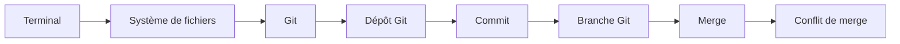
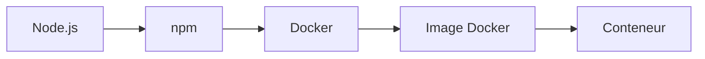

---
tags:
  - index
---
# Chemins de compréhension

> [!info] À quoi ça sert
> Chaque notion s'appuie sur la précédente. Si une étape te semble floue, reviens d'un cran en arrière plutôt que d'avancer : c'est souvent là que se trouve le vrai blocage. Chaque case du schéma est cliquable.

## Du réseau à l'authentification
Comment une requête traverse le web jusqu'à une API protégée.

```mermaid
flowchart LR
  N0["Internet"]
  N1["Client-serveur"]
  N2["HTTP"]
  N3["API"]
  N4["API REST"]
  N5["Endpoint"]
  N6["Express"]
  N7["Middleware"]
  N8["Authentification"]
  N9["JWT"]
  N0 --> N1
  N1 --> N2
  N2 --> N3
  N3 --> N4
  N4 --> N5
  N5 --> N6
  N6 --> N7
  N7 --> N8
  N8 --> N9
  class N0 internal-link;
  class N1 internal-link;
  class N2 internal-link;
  class N3 internal-link;
  class N4 internal-link;
  class N5 internal-link;
  class N6 internal-link;
  class N7 internal-link;
  class N8 internal-link;
  class N9 internal-link;
```

[[Internet]] → [[Client-serveur]] → [[HTTP]] → [[API]] → [[API REST]] → [[Endpoint]] → [[Express]] → [[Middleware]] → [[Authentification]] → [[JWT]]

## Du terminal aux conflits Git
Comment on passe de « taper des commandes » à « travailler à plusieurs sur le même code ».

[[Terminal]] → [[Système de fichiers]] → [[Git]] → [[Dépôt Git]] → [[Commit]] → [[Branche Git]] → [[Merge]] → [[Conflit de merge]]

## De l'application au conteneur
Comment une application qu'on sait lancer à la main devient un paquet reproductible.

[[Node.js]] → [[npm]] → [[Docker]] → [[Image Docker]] → [[Conteneur]]

> [!tip] Vue graphique
> Ouvre la vue graphique (`Ctrl+G`) : concepts en violet, commandes en bleu, exercices en vert, erreurs en rouge, cours en orange.
