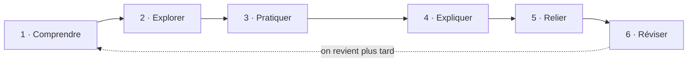

---
tags:
  - index
---
# Méthode d'apprentissage

> [!abstract] La règle d'or
> **Un seul sujet actuel à la fois.** Les autres notions intéressantes vont dans *À apprendre ensuite* ou dans le *Parking* de [[Focus]] : elles ne sont pas perdues, elles attendent leur tour.

Chaque fiche concept suit exactement ces six étapes. Quand tu termines une étape, ajoute-la dans la propriété `method` de la fiche : la barre d'étapes se colore.

| Étape | Ce que je fais | Où dans le vault |
| --- | --- | --- |
| **1 · Comprendre** | Définition, pourquoi la notion existe, quel problème elle résout | Fiche concept, section 1 · [[Cours]] |
| **2 · Explorer** | Comment ça marche, schéma, exemple, ce qu'il ne faut pas confondre | Fiche concept, section 2 · [[Ressources]] |
| **3 · Pratiquer** | Faire un exercice, taper les commandes moi-même | [[Exercices et projets]] · [[Commandes]] |
| **4 · Expliquer** | Écrire le résumé **avec mes mots, sans regarder** | Fiche concept, section 4 |
| **5 · Relier** | Vérifier les prérequis et les notions voisines | Fiche concept, section 5 · vue graphique |
| **6 · Réviser** | Me faire interroger par Claude sur la notion, planifier la prochaine révision | [[Révisions]] |

## Les quatre états d'une notion

| État | Quand l'utiliser |
| --- | --- |
| **À découvrir** | Je ne l'ai pas encore étudiée |
| **En cours** | Je suis en train de l'apprendre (idéalement une ou deux notions à la fois) |
| **Compris** | Je l'explique avec mes mots et j'ai fait au moins un exercice |
| **Maîtrisé** | **Tous les exercices** liés à la notion sont réussis (section *Validation de la maîtrise*) |

> [!warning] Lire n'est pas maîtriser
> Une fiche lue reste *en cours*. Passer en *compris* demande d'avoir **expliqué** (section 4) et **pratiqué** (section 3). Passer en *maîtrisé* demande d'avoir réussi tous les exercices qui utilisent la notion : le [[Dashboard]] et la page [[Révisions]] signalent toute maîtrise non confirmée.

## Une session type (45 min)
1. Ouvrir le [[Dashboard]] : regarder le **sujet actuel** et les **révisions du jour**.
2. 10 min de révision : répondre aux questions repliées des fiches dues, sans les ouvrir d'abord.
3. 30 min sur le sujet actuel : avancer d'une ou deux étapes de la méthode.
4. 5 min pour finir : mettre à jour `method`, `status` et `next_review`, noter les idées hors sujet dans le *Parking*.

## Espacer les révisions
Après chaque révision réussie, repousse `next_review` : **+1 jour → +3 → +7 → +14 → +30**. Si tu as séché, reviens à +1 jour.
