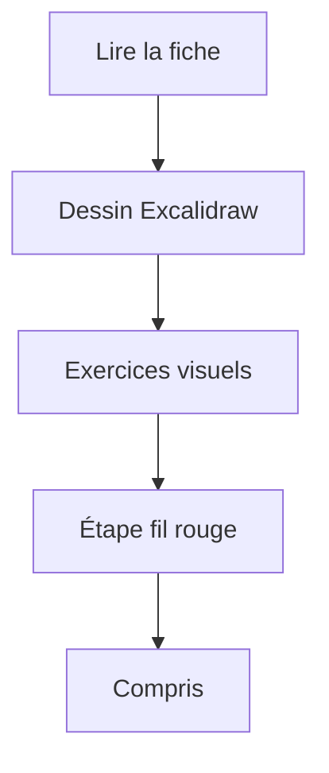

---
tags:
  - index
---
# Méthode d'apprentissage

> [!abstract] La règle d'or
> **Un niveau à la fois, une notion à la fois.** Le [[Dashboard]] ne montre que ton niveau actuel ([[Niveaux]]). Le reste attend dans [[Référence travail]] : rien n'est perdu.

## Pour chaque notion
| Étape | Ce que je fais | Où |
| --- | --- | --- |
| **1 · Comprendre** | Pourquoi la notion existe, quel problème elle résout | Fiche, section 1 |
| **2 · Explorer** | Comment ça marche, ce qu'il ne faut pas confondre. La syntaxe est dans la boîte repliée « Comment ça s'écrit » : à chercher, pas à apprendre | Fiche, section 2 · [[Commandes]] |
| **3 · Pratiquer** | Faire mon schéma Excalidraw, les exercices visuels, puis **tout de suite** l'étape du fil rouge | Fiche, section 3 · [[Exercices et projets]] |
| **4 · Relier** | Voir les notions voisines | Fiche, section 4 |
| **5 · Réviser** | Me faire interroger par Claude dans le chat | [[Révisions]] |

> [!tip] Un concept, une fiche
> Un `if` reste un `if` en Python ou en JavaScript : une seule fiche par concept. Les différences d'écriture sont dans la boîte « Comment ça s'écrit ». Méthode Pareto : comprendre l'idée, chercher la syntaxe quand j'en ai besoin.

## Les trois cases
Chaque fiche a trois cases dans ses propriétés :
- `schema` : j'ai fait mon dessin Excalidraw de la notion ;
- `exercice_visuel` : j'ai fait les exercices visuels de la fiche ;
- `fil_rouge` : je l'ai appliquée dans l'étape du fil rouge.

| État | Quand |
| --- | --- |
| **À découvrir** | Pas encore commencée |
| **En cours** | Au moins une case cochée |
| **Compris** | Les trois cases cochées (calculé tout seul) |
| **Maîtrisé** | **Moi seul** le décide, quand je sens que je l'explique de façon fluide et que je l'adapte à un autre contexte |

## Valider un niveau
Un niveau est validé quand son fil rouge est terminé et que toutes ses notions sont *compris*. Alors je passe `niveau_actuel` au niveau suivant dans [[Focus]].

## Une session type (45 min)
1. Ouvrir le [[Dashboard]] : la prochaine notion et la prochaine étape du fil rouge.
2. 10 min : lire la fiche.
3. 25 min : dessin, exercices visuels, étape du fil rouge. Cocher les cases.
4. 10 min : me faire interroger par Claude sur une notion déjà vue.
