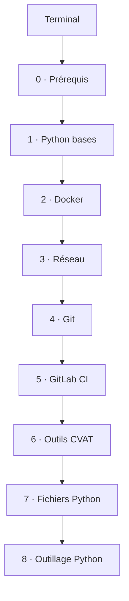

---
tags:
  - index
---
# Parcours - Python, Docker et CI

> [!info] À quoi sert ce parcours
> L'ordre conseillé pour construire des bases solides avant le projet CVAT : écrire un script Python qui manipule et zippe des fichiers, le faire tourner dans Docker, puis le construire et le tester dans GitLab CI. Chaque étape s'appuie sur la précédente. Pour chaque fiche : lire, pratiquer, écrire **avec mes mots**, puis demander à Claude de m'interroger.

## Avant tout · Maîtriser le terminal
**Cours**, dans l'ordre : [[Cours - Terminal, shell et système]] → [[Cours - WSL, Linux dans Windows]] → [[Cours - Bash, les commandes essentielles]] → [[Cours - Linux, utilisateurs, permissions et paquets]] → [[Cours - Écrire un script shell]] → [[Cours - PowerShell et Bash côte à côte]]
1. [[Terminal]] et [[Shell]]
2. [[Système d'exploitation et noyau]] · [[Distribution Linux]] · [[Variable PATH]]
3. [[PowerShell]] et [[Bash]]
4. [[WSL]] · commande [[wsl.exe]]
5. Commandes : [[pwd]] · [[ls]] · [[cd]] · [[mkdir]] · [[cp]] · [[mv]] · [[rm]] · [[cat]] · [[grep]]
6. [[Redirection et pipe]]
7. [[Processus]]
8. [[Permissions Linux]] · [[chmod]] · [[sudo]]
9. [[Gestionnaire de paquets]] · [[apt]]
10. [[Script shell]]

**Exercice** : [[Exercice - Prendre en main WSL et Bash]]

## Étape 0 · Prérequis
**Cours** : [[Cours - Ce que tout programme reçoit et renvoie]]
1. [[Système de fichiers]]
2. [[Variable d'environnement]]
3. [[Code de sortie]]
4. [[JSON]] puis [[YAML]]
5. [[Fichiers entre Windows et Linux]]

## Étape 1 · Python, les bases
**Cours** : [[Cours - Python, premiers pas]] puis [[Cours - Fonctions, modules et erreurs]]
1. [[Python]] · commande [[python script.py]]
2. [[Variables et types en Python]]
3. [[Condition (if)]]
4. [[Boucle (for, while)]]
5. [[Liste et dictionnaire]]
6. [[Fonction]]
7. [[Module et import Python]]
8. [[Exception]]

## Étape 2 · Docker
**Cours** : [[Cours - Docker, les bases solides]] puis [[Cours - Faire tourner un script Python dans Docker]]

> [!tip] Sans les étapes 7 et 8
> Le second cours utilise un script de zip et un `requirements.txt`. Prends un petit script de l'étape 1 (ou le script de zip tel quel, sans chercher à tout comprendre) : ici, le but est Docker, pas Python.
1. [[Docker]] et [[Démon Docker]]
2. [[Dockerfile]] et [[Image Docker]] (couches, cache, image dérivée)
3. [[Conteneur]]
4. [[Volume Docker]]
5. [[Python dans Docker]]
6. [[Docker Compose]] · commande [[docker compose up]]
7. [[Registre Docker]] (Docker Hub, ghcr.io, miroirs) et [[Nexus]]

## Étape 3 · Réseau
**Cours** : [[Cours - Ports, proxy et reverse proxy]]
1. [[Port]]
2. [[Proxy]]
3. [[Reverse proxy]] (Traefik et `CVAT_HOST`)

## Étape 4 · Git dans un vrai projet
**Cours** : [[Cours - Git propre dans un vrai projet]]
1. [[Convention de commit]] (`fix`, `ci`…)
2. [[Tag Git]] · commande [[git tag]]
3. Commandes [[git diff]] et [[git grep]]
4. [[Changelog]]

## Étape 5 · GitLab CI
**Cours** : [[Cours - Maîtriser le fichier de pipeline GitLab]] puis [[Cours - Construire et publier les images d'un projet avec GitLab CI]]
1. [[Pipeline GitLab CI]] (jobs, stages, `needs`, états)
2. [[Variables CI-CD GitLab]]
3. [[Règles d'un job GitLab (rules)]] (manuel, `allow_failure`, skipped)
4. [[Artefacts GitLab CI]]
5. [[extends GitLab CI]]
6. [[Construire une image dans la CI]] (Docker-in-Docker) et [[Kaniko]]
7. [[Tester l'image, pas le dépôt]]

## Étape 6 · Outils du projet CVAT
1. [[OpenAPI]]
2. [[SDK]]

> [!note] À maîtriser en dernier
> Ces deux étapes viennent après la CI : tu les approfondiras quand tu en auras besoin dans tes scripts. D'ici là, les cours Docker et CI te montrent juste ce qu'il faut (`pip install -r requirements.txt`, un `pytest` lancé dans un job) sans que tu aies à tout maîtriser.

## Étape 7 · Python et les fichiers
**Cours** : [[Cours - Manipuler des fichiers et des archives]]
1. [[Chemin de fichier en Python (pathlib)]]
2. [[Lire et écrire un fichier]]
3. [[Copier et déplacer des fichiers (shutil)]]
4. [[Archive zip (zipfile)]]
5. [[Arguments de ligne de commande]]

## Étape 8 · Outillage Python
**Cours** : [[Cours - Installer des dépendances et tester]]
1. [[Environnement virtuel Python]]
2. [[pip]] · commande [[pip install]]
3. [[pytest]]

**Cours** : [[Cours - Python au quotidien]]
4. [[Appeler une API HTTP (requests)]]
5. [[Lire et écrire du CSV]]
6. [[Dates et heures (datetime)]]
7. [[Journaliser avec logging]]
8. [[Lancer une commande (subprocess)]]
9. [[Expressions régulières (re)]]

## Les réflexes, à relire avant chaque séance de débogage
[[Fiche - Réflexes pour déboguer une pipeline]] : lire le log depuis la première erreur, partir des fichiers de ta version, un changement = un commit = un pipeline, vérifier ce qu'un test teste avant de le débloquer.

> [!tip] Le fil rouge
> Le même petit projet traverse tout le parcours : ton script de zip. Conteneurisé en étape 2, versionné proprement en étape 4, construit par la CI en étape 5, puis réécrit et testé à fond en étapes 7 et 8, quand tu maîtriseras Python.
