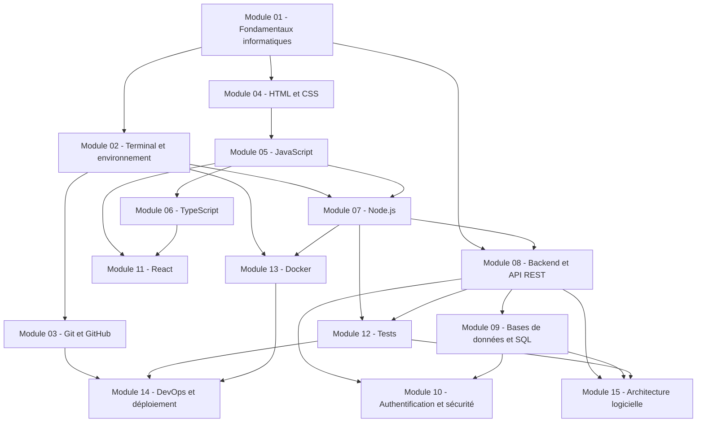

---
cssclasses:
  - dw-wide
tags:
  - index
---
# Parcours

> [!info] Comment lire ce parcours
> Chaque module dépend de ceux qui le précèdent sur le schéma. La progression d'un module est calculée à partir du statut de ses notions : *à découvrir* 0 · *en cours* 1/3 · *compris* 2/3 · *maîtrisé* 3/3. Clique sur un module pour l'ouvrir.



```dataviewjs
await dv.view("10 — Templates/Scripts/learning", { view: "parcours" })
```

Voir aussi : [[Méthode d'apprentissage]] · [[Chemins de compréhension]] · [[Suivi des acquis]]
