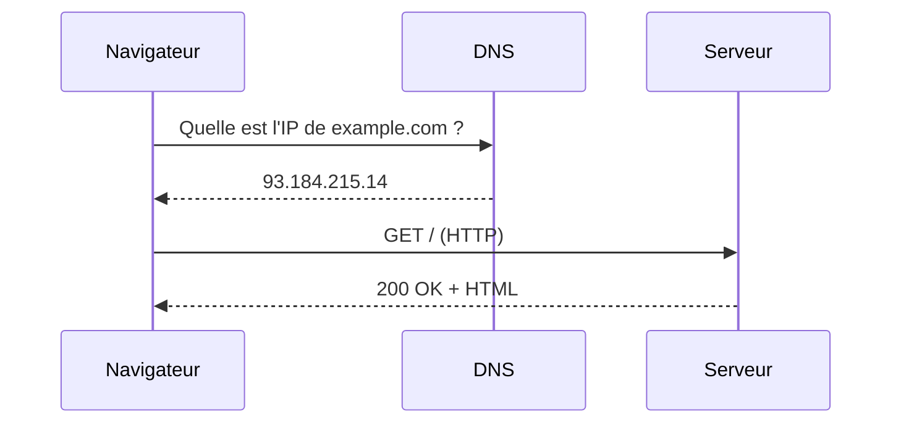

# Cours - Comment fonctionne le web

> [!abstract] Objectifs
> - Comprendre le trajet d'une requête de ton navigateur jusqu'à un serveur
> - Lire une requête et une réponse HTTP
> - Savoir ce qu'est un code de statut

**Prérequis :** [[Système de fichiers]]

## 1. Ce qui se passe quand tu tapes une adresse

1. Le **DNS** traduit le nom en adresse IP (voir [[Internet]]).
2. Le navigateur, **client**, ouvre une connexion vers le **serveur** ([[Client-serveur]]).
3. Il envoie une **requête [[HTTP]]** ; le serveur renvoie une **réponse** avec un code de statut.

## 2. Une requête se lit en quatre parties
Méthode, chemin, en-têtes, corps. Exemple : `POST /notes` avec un corps [[JSON]].

## 3. Tester soi-même
```bash
curl -i https://api.github.com/users/octocat
```
L'option `-i` affiche les en-têtes de la réponse : repère le code `200` et `Content-Type: application/json`.

## Mise en pratique
- Ouvre les outils de développement du navigateur (F12) → onglet *Réseau*, recharge une page et observe méthodes, codes et types de contenu.

> [!warning] Erreurs fréquentes
> - Confondre HTTP (le protocole) et HTML (le contenu d'une page)
> - Croire que le serveur « se souvient » de toi : HTTP est sans état

## Résumé
Une page web, c'est une conversation client-serveur : une requête HTTP part, une réponse revient avec un code de statut et un contenu (HTML, JSON…).

## Concepts du cours
[[Internet]] · [[Client-serveur]] · [[HTTP]] · [[JSON]]
