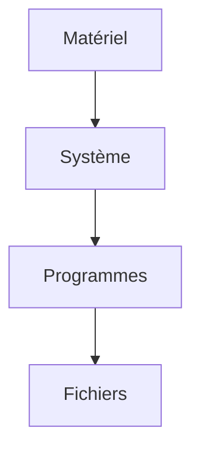

# Cours - Comment fonctionne un ordinateur

> [!abstract] Objectifs
> - Savoir ce que sont un bit, un octet, un Mo
> - Expliquer le rôle du processeur, de la mémoire et du disque
> - Comprendre pourquoi des accents s'affichent mal
> - Situer le système d'exploitation

**Prérequis :** Aucun : c'est le point de départ.

## 1. Tout est nombre
L'ordinateur ne manipule que des bits ; 8 bits = un octet. Un texte, une image, un programme sont des suites d'octets ; c'est la façon de les lire qui leur donne un sens. Voir [[Binaire et octet]].

## 2. Schéma

## 3. Les pièces de la machine
Le processeur calcule, la mémoire vive garde ce qui sert maintenant, le disque garde tout. Voir [[Processeur, mémoire et disque]].

## 4. Le chef d'orchestre
Le [[Système d'exploitation et noyau|système d'exploitation]] partage le matériel entre les programmes et offre les fichiers, le réseau, les processus. Son cœur, le [[Noyau (kernel)|noyau]], est le seul à toucher au matériel : les programmes lui demandent tout par des appels système.

## 5. Le texte
Un caractère devient des octets selon un [[Encodage des caractères|encodage]]. Règle d'or : **UTF-8 partout**, et toujours préciser l'encodage quand on lit ou écrit un fichier.

## Mise en pratique
- Fais l'[[Exercice - Explorer sa machine, ses octets et ses encodages]].

> [!warning] Erreurs fréquentes
> - Confondre mémoire (RAM) et stockage (disque)
> - Confondre Mb (bits) et Mo (octets)
> - Laisser l'encodage par défaut et récupérer des `é`

## Résumé
En 3 phrases, avec mes mots.

## Concepts du cours
[[Binaire et octet]] · [[Processeur, mémoire et disque]] · [[Encodage des caractères]] · [[Système d'exploitation et noyau]] · [[Noyau (kernel)]]
