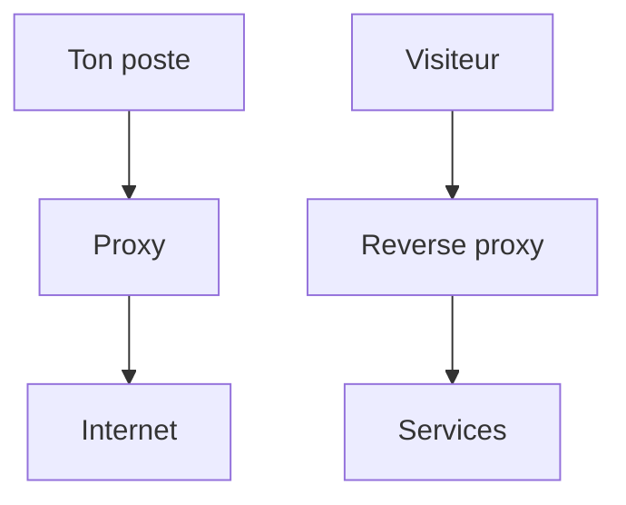

# Cours - Ports, proxy et reverse proxy

> [!abstract] Objectifs
> - Savoir à quoi sert un port et lire `-p 8080:80`
> - Comprendre pourquoi les téléchargements passent par un proxy ou le Nexus en entreprise
> - Comprendre pourquoi un reverse proxy route selon le nom d'hôte

**Prérequis :** [[Client-serveur]] · [[HTTP]] · [[Variable d'environnement]]

## 1. Une adresse ne suffit pas
L'adresse IP désigne une machine. Le [[Port]] désigne le programme qui doit répondre. `localhost:8080` = « ma machine, le programme qui écoute sur 8080 ».

## 2. Schéma : les deux sens

## 3. Sortir : le proxy
En entreprise, les connexions vers Internet passent par un [[Proxy]]. Chaque outil doit le connaître (`HTTPS_PROXY`, `NO_PROXY`). Pour Docker, c'est le démon, le build et le conteneur qui ont chacun besoin du réglage. Souvent, la solution est de ne **pas** sortir : tout télécharger depuis le [[Nexus]].

Le proxy est un programme (Squid, Zscaler) qui fait la requête **à ta place** : il peut filtrer, journaliser, mettre en cache et demander qui tu es (`407`). Ton poste le connaît par un réglage manuel, un fichier PAC, un agent installé, ou pas du tout s'il est transparent.

## 4. Entrer : le reverse proxy
Une application faite de plusieurs conteneurs a besoin d'une porte d'entrée unique : le [[Reverse proxy]] (nginx, Traefik). Il **route** chaque requête vers le bon service, **gère le HTTPS** et **répartit la charge** entre plusieurs copies. Traefik, par exemple, route souvent selon le **nom d'hôte** : l'appli n'est joignable que sous le nom qu'on lui a donné.

> [!warning] Ni l'un ni l'autre n'est une API
> Une API offre un service et produit la réponse. Le proxy et le reverse proxy ne produisent rien : ils **transmettent** des requêtes destinées à d'autres.

## 5. Ports et conteneurs
- `-p 8080:80` : port 8080 de ta machine → port 80 du conteneur.
- Entre conteneurs d'un même compose : nom du service + port **interne** (`cvat_db:5432`).
- Dans un conteneur, un serveur doit écouter sur `0.0.0.0`, pas `127.0.0.1`.

## Mise en pratique
- Pour chaque notion du cours : les **exercices visuels** de sa fiche (section 3), puis le fil rouge de son niveau ([[Niveaux]]).

> [!warning] Erreurs fréquentes
> - Inverser les deux côtés de `-p`
> - Appeler une appli avec un autre nom d'hôte que celui configuré et croire qu'elle est cassée
> - Régler le proxy dans le terminal et s'étonner que `docker pull` ne passe pas (c'est le démon qui télécharge)

## Résumé
Pas de résumé à écrire : si tu veux, fais un dessin Excalidraw qui relie les notions ci-dessous.

## Concepts du cours
[[Port]] · [[Proxy]] · [[Reverse proxy]]
