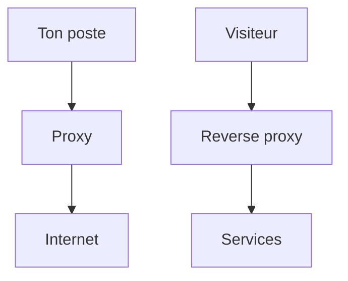

# Cours - Ports, proxy et reverse proxy

> [!abstract] Objectifs
> - Savoir à quoi sert un port et lire `-p 8080:80`
> - Comprendre pourquoi les téléchargements passent par un proxy ou le Nexus en entreprise
> - Comprendre le rôle de Traefik et de `CVAT_HOST` dans CVAT

**Prérequis :** [[Client-serveur]] · [[HTTP]] · [[Variable d'environnement]]

## 1. Une adresse ne suffit pas
L'adresse IP désigne une machine. Le [[Port]] désigne le programme qui doit répondre. `localhost:8080` = « ma machine, le programme qui écoute sur 8080 ».

## 2. Schéma : les deux sens

## 3. Sortir : le proxy
En entreprise, les connexions vers Internet passent par un [[Proxy]]. Chaque outil doit le connaître (`HTTPS_PROXY`, `NO_PROXY`). Pour Docker, c'est le démon, le build et le conteneur qui ont chacun besoin du réglage. Souvent, la solution est de ne **pas** sortir : tout télécharger depuis le [[Nexus]].

## 4. Entrer : le reverse proxy
Une application faite de plusieurs conteneurs a besoin d'une porte d'entrée unique : le [[Reverse proxy]]. Dans CVAT, c'est Traefik ; il route selon le nom d'hôte, d'où la variable `CVAT_HOST`.

## 5. Ports et conteneurs
- `-p 8080:80` : port 8080 de ta machine → port 80 du conteneur.
- Entre conteneurs d'un même compose : nom du service + port **interne** (`cvat_db:5432`).
- Dans un conteneur, un serveur doit écouter sur `0.0.0.0`, pas `127.0.0.1`.

## Mise en pratique
- Explique avec tes mots le chemin d'une requête de ton navigateur jusqu'à l'API de CVAT.
- Liste les endroits où il faudrait déclarer un proxy pour que `docker build` d'une image Python marche.

> [!warning] Erreurs fréquentes
> - Inverser les deux côtés de `-p`
> - Appeler CVAT avec un autre nom que `CVAT_HOST` et croire que l'application est cassée
> - Régler le proxy dans le terminal et s'étonner que `docker pull` ne passe pas (c'est le démon qui télécharge)

## Résumé
En 3 phrases, avec mes mots.

## Concepts du cours
[[Port]] · [[Proxy]] · [[Reverse proxy]]
