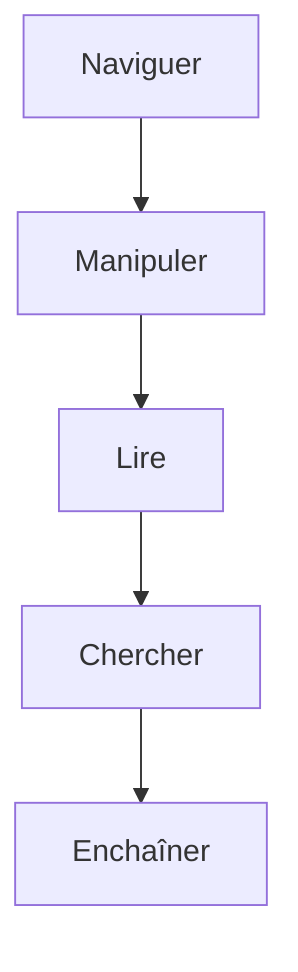

# Cours - Bash, les commandes essentielles

> [!abstract] Objectifs
> - Se déplacer et manipuler fichiers et dossiers sans souris
> - Lire et chercher dans des fichiers
> - Enchaîner des commandes avec des pipes et des redirections
> - Gérer un programme qui tourne

**Prérequis :** [[Cours - WSL, Linux dans Windows]]

## 1. Se repérer
```bash
pwd                 # où suis-je
ls -la              # quoi ici (même caché)
cd ~/projets        # aller ; cd .. remonter ; cd - revenir au précédent
```
Voir [[pwd]] · [[ls]] · [[cd]]. `Tab` complète les noms : utilise-le tout le temps.

## 2. Schéma : la boîte à outils


## 3. Manipuler
```bash
mkdir -p a/b/c            # créer (avec les parents)
touch notes.txt           # créer un fichier vide
cp f.txt copie.txt        # copier ; cp -r pour un dossier
mv f.txt docs/            # déplacer ou renommer
rm f.txt                  # supprimer ; rm -r dossier — définitif, pas de corbeille
```
Voir [[mkdir]] · [[touch]] · [[cp]] · [[mv]] · [[rm]].

## 4. Créer un fichier et écrire dedans
Il y a trois façons, selon ce que tu veux mettre dedans.

**Un fichier vide** : [[touch]]
```bash
touch notes.txt                  # crée notes.txt (vide)
touch a.png b.png c.png          # plusieurs d'un coup
```

**Une ou quelques lignes** : [[echo]] et une redirection
```bash
echo "# Mes notes" > notes.txt      # > crée le fichier, ou ÉCRASE son contenu
echo "ligne 2" >> notes.txt         # >> AJOUTE à la fin
cat notes.txt                       # vérifier
```
Plusieurs lignes d'un coup, avec un *here document* (tout jusqu'au mot `EOF`) :
```bash
cat > config.txt <<'EOF'
CVAT_URL=http://localhost:8080
DOSSIER=./images
EOF
```

**Un vrai contenu (un script, du code)** : un éditeur
```bash
nano archiver.sh     # éditeur dans le terminal : Ctrl+O puis Entrée pour enregistrer, Ctrl+X pour quitter
code archiver.sh     # ou VS Code, plus confortable sur ta machine
```
Voir [[nano]] · [[code]].

| Je veux… | Bash (WSL) | PowerShell |
| --- | --- | --- |
| un fichier vide | `touch f.txt` | `New-Item f.txt` |
| écrire (remplacer) | `echo "x" > f.txt` | `Set-Content f.txt "x"` |
| ajouter une ligne | `echo "x" >> f.txt` | `Add-Content f.txt "x"` |
| éditer | `nano f.txt` · `code f.txt` | `notepad f.txt` · `code f.txt` |

> [!warning] Le piège du `>`
> `>` vide le fichier **avant** d'écrire, sans demander. `echo "x" > notes.txt` sur un fichier rempli efface tout. Pour ajouter, c'est `>>`.

## 5. Lire
```bash
cat court.txt             # tout afficher
less long.log             # page par page (q pour quitter, / pour chercher)
head -20 f.log ; tail -20 f.log ; tail -f f.log   # début, fin, suivre en direct
```
Voir [[cat]].

## 6. Chercher
```bash
grep -rn "CVAT_HOST" .            # un texte dans les fichiers
find . -name "*.png"              # des fichiers par nom
find . -name "*.log" -size +1M    # par taille
```
Voir [[grep]].

## 7. Enchaîner
```bash
ls *.png | wc -l
grep -rn "ERROR" logs/ | sort | uniq | head
python script.py > sortie.txt 2>&1
cmd1 && cmd2      # cmd2 seulement si cmd1 réussit
cmd1 || cmd2      # cmd2 seulement si cmd1 échoue
```
`wc -l` compte les lignes (voir [[wc]]) : `ls *.png | wc -l` compte les PNG.
Voir [[Redirection et pipe]] et [[Code de sortie]].

## 8. Les programmes qui tournent
`Ctrl+C` interrompt, `&` lance en arrière-plan, `ps aux | grep nom` retrouve, `kill PID` arrête. Voir [[Processus]].

## 9. S'aider soi-même
`commande --help`, `man commande`, `type commande` (intégrée ou programme ?), `which commande` (où est le programme).

## Mise en pratique
- Refais l'[[Exercice - Naviguer dans le terminal]], mais dans WSL.
- Dans un dépôt cloné, trouve en une ligne combien de fichiers `.py` il contient.
- Trouve les 10 lignes contenant `FROM` dans tous les Dockerfile du dépôt CVAT.

> [!warning] Erreurs fréquentes
> - `rm -rf` lancé dans le mauvais dossier : toujours `pwd` avant, et jamais `rm -rf /` ou `rm -rf ~`
> - Oublier les guillemets autour d'un nom qui contient des espaces
> - Taper les noms au lieu d'utiliser `Tab` : fautes de frappe et de casse
> - Rester bloqué dans `less` ou `man` : `q` pour sortir

## Résumé
En 3 phrases, avec mes mots.

## Concepts du cours
[[Bash]] · [[Système de fichiers]] · [[Redirection et pipe]] · [[Processus]]
