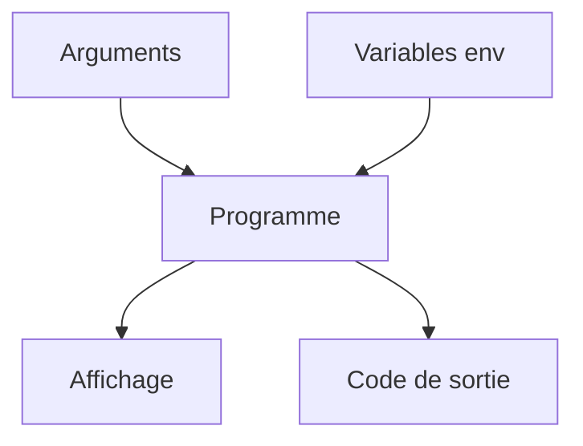

# Cours - Ce que tout programme reçoit et renvoie

> [!abstract] Objectifs
> - Savoir comment un programme reçoit sa configuration (variables d'environnement)
> - Savoir comment il dit s'il a réussi (code de sortie)
> - Lire un fichier YAML sans se tromper d'indentation
> - Éviter les pièges des fichiers écrits sous Windows et lancés sous Linux

**Prérequis :** [[Terminal]] · [[Système de fichiers]]

## 1. Un programme, vu de l'extérieur
Un script Python, une commande `docker` ou un job de CI sont tous des **programmes**. Vu de l'extérieur, un programme :
- **reçoit** des arguments (`python zipper.py dossier/`) et des [[Variable d'environnement|variables d'environnement]] ;
- **lit et écrit** des fichiers ;
- **affiche** du texte sur deux canaux : la sortie normale (*stdout*) et la sortie d'erreur (*stderr*) ;
- **renvoie** un [[Code de sortie]] en s'arrêtant.

Ces quatre points sont la base de tout ce qui suit : Docker et la CI ne font que lancer des programmes et regarder leur code de sortie.

## 2. Schéma

## 3. Configurer sans toucher au code
Les [[Variable d'environnement|variables d'environnement]] servent à régler un programme de l'extérieur. La même image Docker peut tourner avec `-e DOSSIER=/data` sur ton poste et une autre valeur en production. Dans la CI, GitLab en fournit beaucoup ([[Variables CI-CD GitLab]]).

## 4. Réussir ou échouer
Le [[Code de sortie]] est le seul verdict qui compte pour une machine. Une ligne de `script:` qui renvoie 1 fait échouer le job, même si tout le reste du log semble normal. C'est pour ça qu'un script Python doit **sortir en erreur** quand il échoue, au lieu d'afficher un message et de continuer.

## 5. Le YAML, langue de la configuration
La CI GitLab et docker compose se décrivent en [[YAML]]. Deux règles suffisent au début : l'indentation (avec des espaces) donne la structure, et `- ` commence un élément de liste.

## 6. Écrire sous Windows, lancer sous Linux
Ton code tourne dans des conteneurs Linux. Les [[Fichiers entre Windows et Linux]] diffèrent sur trois points : le droit d'exécution, les majuscules dans les noms et les fins de ligne.

## Mise en pratique
- Lance `python --version`, puis affiche son code de sortie. Recommence avec une commande inventée.
- Définis une variable `DOSSIER` et vérifie qu'un programme lancé ensuite la voit.
- Écris en YAML la liste de tes trois outils préférés, avec pour chacun un nom et une version.

> [!warning] Erreurs fréquentes
> - Oublier `export` en Bash : la variable n'est pas transmise au programme
> - Croire qu'un job CI a réussi parce que le log affiche un message rassurant : seul le code de sortie compte
> - Mélanger tabulations et espaces dans un YAML

## Résumé
En 3 phrases, avec mes mots.

## Concepts du cours
[[Variable d'environnement]] · [[Code de sortie]] · [[YAML]] · [[Fichiers entre Windows et Linux]]
