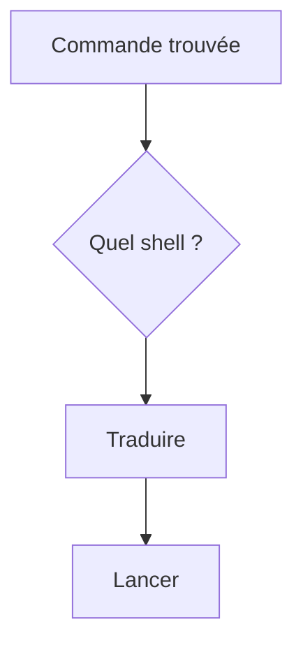

# Cours - PowerShell et Bash côte à côte

> [!abstract] Objectifs
> - Traduire les commandes courantes d'un shell à l'autre
> - Éviter les pièges des alias PowerShell
> - Adapter une commande trouvée sur Internet au shell où je suis

**Prérequis :** [[Cours - Terminal, shell et système]] · [[Cours - Bash, les commandes essentielles]]

## 1. La règle
Les **programmes** (`git`, `python`, `docker`, `code`) s'écrivent pareil. Ce qui change : les commandes de fichiers, les variables, les chemins, les enchaînements.

## 2. Schéma

## 3. La table d'équivalences
| Action | Bash (WSL) | PowerShell |
| --- | --- | --- |
| Où suis-je | `pwd` | `Get-Location` (`pwd`) |
| Lister, même caché | `ls -la` | `Get-ChildItem -Force` |
| Changer de dossier | `cd ~/projets` | `cd ~\projets` |
| Créer des dossiers | `mkdir -p a/b` | `New-Item -ItemType Directory -Force a\b` (`mkdir a\b`) |
| Copier un dossier | `cp -r src dst` | `Copy-Item -Recurse src dst` |
| Déplacer / renommer | `mv a b` | `Move-Item a b` |
| Supprimer un dossier | `rm -rf d` | `Remove-Item -Recurse -Force d` |
| Afficher un fichier | `cat f` | `Get-Content f` (`cat`) |
| Fin d'un fichier en direct | `tail -f f` | `Get-Content f -Wait -Tail 20` |
| Chercher un texte | `grep -rn "x" .` | `Select-String -Path *.* -Pattern "x"` (ou `git grep`) |
| Trouver des fichiers | `find . -name "*.png"` | `Get-ChildItem -Recurse -Filter *.png` |
| Variable d'environnement | `export X=1` · `$X` | `$env:X = "1"` · `$env:X` |
| Où est un programme | `which git` | `Get-Command git` |
| Processus | `ps aux` · `kill 12` | `Get-Process` · `Stop-Process -Id 12` |
| Dossier courant (Docker `-v`) | `"$PWD"` | `"${PWD}"` |
| Continuer une ligne | `\` en fin de ligne | `` ` `` (accent grave) en fin de ligne |

## 4. Les pièges
- `ls -la`, `rm -rf`, `cp -r` **échouent** en PowerShell : les alias n'acceptent pas les options Linux.
- `curl` dans Windows PowerShell 5 n'est pas le vrai curl : écris `curl.exe`.
- Les chemins : `\` sous Windows, `/` sous Linux. PowerShell accepte souvent les deux ; Bash, jamais `\`.
- Les guillemets : en Bash, `'...'` empêche de remplacer les `$VAR`, `"..."` les remplace. En PowerShell, même idée.

## 5. Le bon réflexe
Lis l'invite, puis demande-toi : « cette commande est-elle un **programme** (identique partout) ou une **commande du shell** (à traduire) ? »

## Mise en pratique
- Fais la même tâche dans les deux shells : créer `labo/a/b`, y copier un fichier, chercher un mot dedans, tout supprimer.
- Prends une commande `docker run -v "$PWD/data:/data" ...` trouvée sur Internet et écris sa version PowerShell.

> [!warning] Erreurs fréquentes
> - Utiliser les options Linux avec les alias PowerShell (`ls -la`, `rm -rf`)
> - Utiliser `\` comme séparateur dans WSL
> - Couper une longue commande avec `\` dans PowerShell (il faut l'accent grave)

## Résumé
En 3 phrases, avec mes mots.

## Concepts du cours
[[PowerShell]] · [[Bash]] · [[Shell]] · [[Variable d'environnement]]
