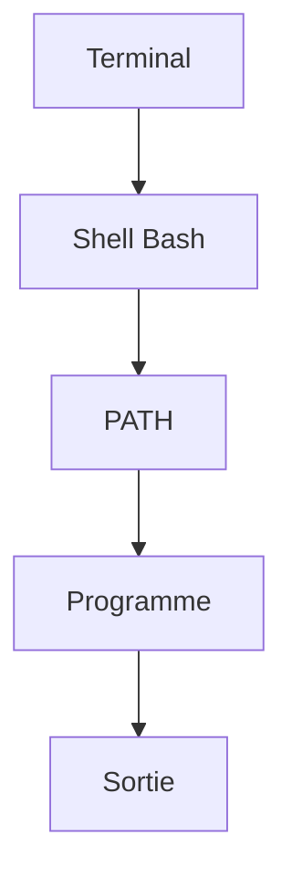

# Cours - Terminal Linux, l'essentiel

Étape 1 du [[Parcours]]. But : être à l'aise dans un terminal Linux (WSL, un conteneur Docker, un serveur, un job de CI : c'est le même Linux partout).

## 1. Ce qui se passe quand tu tapes une commande

Trois pièces :
- le **terminal** : la fenêtre, il affiche seulement ;
- le **shell** (Bash) : il lit ta ligne, la découpe, trouve le programme ;
- le **programme** (`ls`, `git`, `docker`) : il fait le travail et répond.



```bash
docker ps -a
# docker  = le programme (Bash le cherche dans les dossiers du PATH)
# ps      = la sous-commande (ce que docker doit faire)
# -a      = une option (« all » : aussi les conteneurs arrêtés)
```

**À quoi ça sert :** quand une commande « n'existe pas » (`command not found`), c'est le shell qui ne trouve pas le programme dans le PATH. Ce n'est pas le programme qui plante.

## 2. L'arbre des fichiers

Sous Linux, tout part d'une seule racine `/`. Pas de `C:` ni de `D:`.

```text
/
├── home/osall/     ← ton dossier perso, aussi appelé ~
├── etc/            ← la configuration (nginx, hosts…)
├── var/log/        ← les journaux (logs)
├── tmp/            ← fichiers temporaires, vidés au redémarrage
├── usr/bin/        ← les programmes installés
└── mnt/c/          ← ton disque Windows, vu depuis WSL
```

Deux façons d'écrire un chemin :

```bash
cd /home/osall/projets   # chemin ABSOLU : part de la racine /, marche d'où que tu sois
cd projets               # chemin RELATIF : part du dossier où tu es maintenant
cd ..                    # .. = le dossier parent ; . = le dossier courant
cd ~                     # ~ = ton dossier perso
```

**À quoi ça sert :** dans un Dockerfile ou un job de CI, un chemin relatif dépend du dossier courant. Si un fichier « n'existe pas », la première question est : où suis-je ? (`pwd`)

## 3. Se déplacer et manipuler

```bash
pwd                  # où suis-je ?
ls -la               # quoi ici ? (-l = détails, -a = aussi les fichiers cachés qui commencent par .)
cd ~/projets/api     # aller dans un dossier (Tab complète le nom)

mkdir -p logs/2026   # créer un dossier (-p = crée aussi les parents)
cp .env.example .env # copier un fichier
mv vieux.txt neuf.txt  # renommer (ou déplacer)
rm -r build/         # supprimer un dossier : DÉFINITIF, pas de corbeille
```

> [!warning] Piège
> `rm` ne demande rien et il n'y a pas de corbeille. Fais toujours `pwd` avant un `rm -r`.

## 4. Lire et chercher

```bash
cat .env                     # afficher un petit fichier en entier
less app.log                 # lire un gros fichier page par page (q pour quitter, /mot pour chercher)
tail -f app.log              # suivre un log en direct (Ctrl+C pour arrêter)

grep -rn "ConnectionString" .   # chercher un texte dans tous les fichiers (-r dossiers, -n numéro de ligne)
find . -name "*.csproj"          # chercher des fichiers par leur nom
```

**À quoi ça sert :** c'est ce que tu fais le plus au travail : lire un log, retrouver où une valeur est définie.

## 5. Enchaîner : pipe et redirections

Chaque programme a une **entrée** et deux **sorties** : la sortie normale (stdout) et la sortie des erreurs (stderr).

```bash
docker ps | grep api           # | (pipe) : la sortie de gauche devient l'entrée de droite
docker logs api > api.log      # >  : écrit la sortie dans un fichier (ÉCRASE son contenu)
echo "ligne" >> notes.txt      # >> : ajoute à la fin du fichier
dotnet build 2> erreurs.txt    # 2> : envoie seulement les ERREURS dans le fichier
dotnet build > tout.txt 2>&1   # 2>&1 : les erreurs vont au même endroit que la sortie normale
```

Chaque commande renvoie aussi un **code de sortie** : `0` = réussi, autre chose = échec.

```bash
echo $?                        # affiche le code de la dernière commande
dotnet build && dotnet run     # && : lance la 2e SEULEMENT si la 1re a réussi
```

**À quoi ça sert :** une CI s'arrête dès qu'une commande renvoie un code différent de 0. C'est comme ça qu'un job devient rouge.

## 6. Permissions

```bash
ls -l deploy.sh
# -rwxr-x---  1 osall equipe  deploy.sh
#  └┬┘└┬┘└┬┘
#   │  │  └── les autres : rien
#   │  └───── le groupe « equipe » : lire, exécuter
#   └──────── le propriétaire osall : lire (r), écrire (w), exécuter (x)

chmod +x deploy.sh   # rendre le script exécutable
./deploy.sh          # le lancer (./ = « dans le dossier courant »)
sudo apt install jq  # sudo = faire UNE commande en administrateur (root)
```

**À quoi ça sert :** `Permission denied` veut dire soit « pas le droit x » (`chmod +x`), soit « réservé à root » (`sudo`). Dans un conteneur, on est souvent root, sur un serveur rarement.

## 7. Programmes qui tournent (processus)

```bash
ps aux | grep dotnet   # lister les programmes en cours, filtrer sur dotnet
kill 1234              # arrêter le processus numéro 1234 (son PID)
# Ctrl+C               # arrêter le programme lancé dans ce terminal
ss -tlnp               # qui écoute sur quel port ? (utile pour « port already in use »)
```

## 8. Variables d'environnement et PATH

Une variable d'environnement est une valeur que chaque programme lancé reçoit, sans qu'elle soit écrite dans le code.

```bash
echo $HOME                          # lire une variable
export ASPNETCORE_ENVIRONMENT=Development   # la définir pour ce terminal et les programmes lancés après
echo $PATH                          # la liste des dossiers où Bash cherche les programmes, séparés par :
which dotnet                        # où est le programme dotnet trouvé dans le PATH ?
export PATH="$PATH:$HOME/.dotnet/tools"     # ajouter un dossier (c'est ce qu'il fallait pour dotnet-ef)
```

**À quoi ça sert :** c'est comme ça qu'on passe des secrets et des réglages à une appli dans Docker et en CI, sans les mettre dans le code.

## Pièges
> [!warning] Erreurs fréquentes
> - `command not found` : programme absent ou dossier pas dans le PATH (`which`, `echo $PATH`).
> - `No such file or directory` : mauvais dossier courant ou faute dans le chemin (`pwd`, `ls`).
> - `Permission denied` : manque `x` ou besoin de root (`ls -l`, `chmod +x`, `sudo`).
> - `>` au lieu de `>>` : le fichier est vidé.
> - Un nom avec espaces sans guillemets : `cd "Mon dossier"`.

## Mon dessin

> [!todo] Mon schéma (à dessiner au stylet, sans regarder le cours)
> Dessine le trajet d'une commande, par exemple `docker logs api | grep error > erreurs.txt` :
> 1. le terminal, le shell, la recherche dans le PATH, le programme ;
> 2. les trois flux (entrée, sortie normale, erreurs) et où ils vont avec `|` et `>` ;
> 3. le code de sortie qui revient au shell ;
> 4. dans un coin, l'arbre des fichiers : `/`, `~`, `/etc`, `/var/log`, `/mnt/c`, avec un chemin absolu et un chemin relatif.
>
> Ensuite, envoie la photo à Claude : il te dit ce qui est juste et ce qui manque.

## Mes mots
> [!quote] Ce que j'ai compris, avec mes mots
>

## Pour aller plus loin
[[Cours - Bash, les commandes essentielles]] · [[Cours - Linux, utilisateurs, permissions et paquets]] · [[Cours - Écrire un script shell]] · [[Cours - WSL, Linux dans Windows]]
