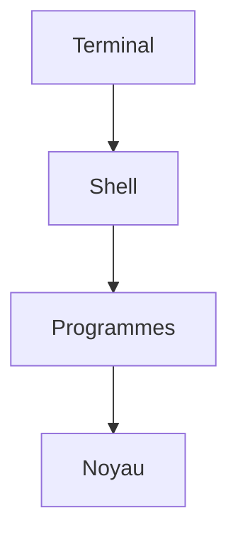

# Cours - Terminal, shell et système

> [!abstract] Objectifs
> - Distinguer terminal, shell et système d'exploitation
> - Reconnaître dans quel shell je suis, rien qu'à l'invite
> - Savoir pourquoi une commande marche dans un shell et pas dans un autre
> - Choisir le bon shell pour une tâche

**Prérequis :** [[Terminal]] · [[Système de fichiers]]

## 1. Trois couches à ne pas mélanger
- Le **terminal** : la fenêtre (Windows Terminal). Il ne comprend rien, il affiche.
- Le **shell** : le programme qui lit tes commandes ([[PowerShell]], [[Bash]], cmd). Voir [[Shell]].
- Le **système** : Windows ou Linux, et son noyau, qui exécute vraiment. Voir [[Système d'exploitation et noyau]].

Le noyau, c'est le **moteur** ; une [[Distribution Linux]] (Ubuntu, Debian, Alpine) est la **voiture complète** : le noyau, plus les outils, plus un gestionnaire de paquets.

## 2. Schéma

## 3. Où suis-je ?
Lis l'invite avant chaque commande :
| Invite | Shell | Système |
| --- | --- | --- |
| `PS C:\Users\oumar>` | PowerShell | Windows |
| `C:\Users\oumar>` | cmd | Windows |
| `oumar@PC:~$` | Bash | Linux (WSL) |
| `oumar@PC MINGW64 ~` | Bash (Git Bash) | Windows |
| `root@3f2a1b:/app#` | Bash ou sh | Linux, **dans un conteneur** |

## 4. Ce qui change et ce qui ne change pas
- **Ne change pas** : les programmes externes (`git`, `python`, `docker`) et leurs options. `git status` est identique partout.
- **Change** : la syntaxe autour (variables, chemins, guillemets, enchaînements) et les commandes intégrées (`ls`, `rm`, `cp` n'ont pas les mêmes options).

### Comment le shell trouve un programme
Quand tu tapes `git`, le shell cherche un fichier `git` dans les dossiers listés par la [[Variable PATH]], dans l'ordre. Le dossier courant n'en fait pas partie : un script se lance avec `./script.sh`. Pour savoir ce que cache un nom : `type ls` en Bash, `Get-Alias ls` ou `Get-Command git` en PowerShell.

## 5. Quel shell choisir
- **PowerShell** : pour Windows lui-même, et quand tout l'outillage est installé côté Windows.
- **Bash dans WSL** : pour tout ce qui finira sous Linux (Docker, CI, scripts `.sh`, serveurs). C'est le choix conseillé pour ton projet CVAT.
- **Git Bash** : un dépannage pratique, mais ce n'est pas un vrai Linux.

Règle simple : **un projet = un côté**. Si le projet vit dans WSL, ouvre-le, lance-le et commite-le depuis WSL.

## Mise en pratique
- Ouvre un onglet de chaque shell et lance `echo $PSVersionTable` / `echo $SHELL` : lequel répond quoi ?
- Pour chaque ligne du tableau du point 3, dis où tu te trouves sans regarder la colonne de droite.

> [!warning] Erreurs fréquentes
> - Coller une commande Bash d'un tutoriel dans PowerShell sans regarder l'invite
> - Croire que `ls` dans PowerShell est le même programme que `ls` sous Linux
> - Mélanger les côtés : cloner sous Windows, lancer sous WSL, commiter sous Windows

## Résumé
En 3 phrases, avec mes mots.

## Concepts du cours
[[Terminal]] · [[Shell]] · [[PowerShell]] · [[Bash]] · [[Système d'exploitation et noyau]]
