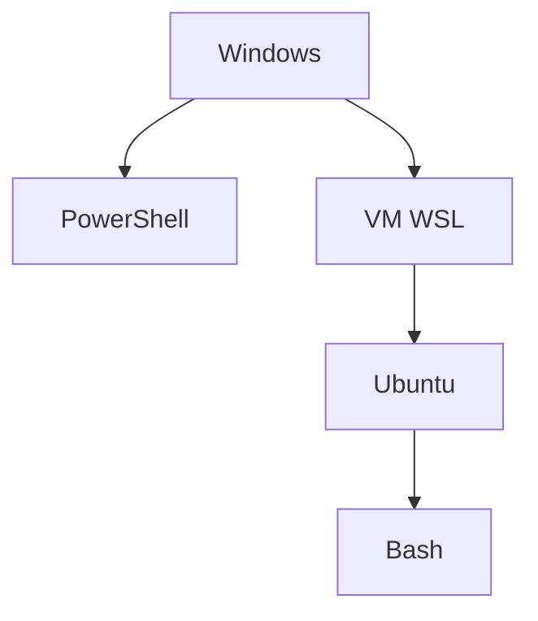

# Cours - WSL, Linux dans Windows

> [!abstract] Objectifs
> - Comprendre ce que WSL est vraiment, et ce qu'il n'est pas
> - Installer et gérer une distribution
> - Circuler entre les fichiers Windows et Linux, et savoir où ranger ses projets
> - Utiliser VS Code, Git et Docker avec WSL

**Prérequis :** [[Cours - Terminal, shell et système]]

## 1. Ce que c'est
[[WSL]] 2 fait tourner un **vrai noyau Linux** dans une machine virtuelle légère que Windows gère pour toi. Tu y installes une distribution (Ubuntu). Ce Linux a ses fichiers, ses utilisateurs, ses programmes — **séparés** de ceux de Windows.

## 2. Schéma


## 3. Installer et gérer
```powershell
wsl --install                 # une fois, puis redémarrer ; Ubuntu demande un nom d'utilisateur et un mot de passe
wsl -l -v                     # liste, état, version
wsl --update                  # mettre à jour le noyau WSL
wsl --shutdown                # tout arrêter
```
Le mot de passe Ubuntu sert à `sudo`. Il ne s'affiche pas quand tu le tapes : c'est normal.

## 4. Deux mondes de fichiers
- Linux voit Windows dans `/mnt/c/`.
- Windows voit Linux dans `\\wsl$\Ubuntu\`.
- **Range tes projets dans `~/projets`** (côté Linux) : beaucoup plus rapide, droits et fins de ligne corrects.
- Depuis Linux : `explorer.exe .` ouvre l'Explorateur ici ; `code .` ouvre VS Code connecté à WSL (extension *WSL*, indiqué en bas à gauche `WSL: Ubuntu`).

## 5. Deux jeux d'outils
Git, Python, Node installés sous Windows **n'existent pas** dans Ubuntu, et inversement. Dans WSL : `sudo apt install git python3 python3-venv`. Configure Git une fois côté Linux aussi (`git config --global user.name ...`).

## 6. Docker et WSL
Docker Desktop tourne **sur** WSL 2. Active *Settings > Resources > WSL integration > Ubuntu* : la commande `docker` marche alors dans Ubuntu, avec le même démon que depuis PowerShell.

## 7. Le réseau
Un serveur lancé dans WSL (`python -m http.server 8000`) est joignable depuis le navigateur Windows sur `http://localhost:8000`. En entreprise, WSL peut avoir besoin du [[Proxy]] (variables `HTTPS_PROXY` dans `~/.bashrc`).

## Mise en pratique
- Fais l'[[Exercice - Prendre en main WSL et Bash]].
- Clone un dépôt dans `~/projets`, ouvre-le avec `code .`, vérifie l'indication `WSL: Ubuntu` dans VS Code.
- Lance `docker version` depuis Ubuntu.

> [!warning] Erreurs fréquentes
> - Travailler dans `/mnt/c/...` depuis WSL : lent, et problèmes de droits et de fins de ligne
> - Modifier des fichiers Linux avec un outil Windows qui ne passe pas par `\\wsl$` (ou l'extension VS Code)
> - Croire que le Git ou le Python de Windows est disponible dans Ubuntu
> - Oublier le mot de passe Ubuntu : il sert à chaque `sudo`

## Résumé
En 3 phrases, avec mes mots.

## Concepts du cours
[[WSL]] · [[Système d'exploitation et noyau]] · [[Bash]] · [[Fichiers entre Windows et Linux]]
