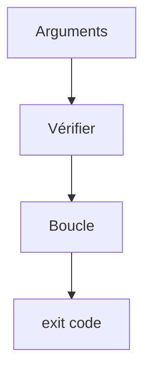

# Cours - Écrire un script shell

> [!abstract] Objectifs
> - Écrire un script Bash qui s'arrête proprement en cas d'erreur
> - Utiliser variables, arguments, conditions et boucles en Bash
> - Savoir quand un script shell suffit et quand passer à Python

**Prérequis :** [[Cours - Bash, les commandes essentielles]] · [[Cours - Linux, utilisateurs, permissions et paquets]]

## 1. Un fichier de commandes
Un [[Script shell]] commence par un shebang et, de préférence, `set -euo pipefail` :
```bash
#!/usr/bin/env bash
set -euo pipefail
echo "Bonjour $USER"
```
`chmod +x bonjour.sh` puis `./bonjour.sh`.

## 2. Schéma


## 3. Variables et arguments
```bash
NOM="Oumar"                 # pas d'espace autour du =
echo "Salut $NOM"
echo "1er argument : $1, tous : $@, nombre : $#"
AUJOURDHUI=$(date +%F)      # résultat d'une commande
```

## 4. Conditions
```bash
if [ -f "$1" ]; then
  echo "fichier"
elif [ -d "$1" ]; then
  echo "dossier"
else
  echo "introuvable" >&2
  exit 1
fi
```

## 5. Boucles
```bash
for f in "$DOSSIER"/*.png; do
  echo "$f"
done
```

## 6. Réussir ou échouer
Le script renvoie le [[Code de sortie]] de sa dernière commande, ou celui de `exit N`. Avec `set -e`, il s'arrête dès qu'une commande échoue : c'est ce qu'on veut dans un `entrypoint.sh` ou un job de CI.

## 7. Shell ou Python ?
- **Shell** : enchaîner quelques commandes existantes (`git`, `docker`, `zip`).
- **Python** : dès qu'il y a de la logique (filtres, calculs, JSON, gestion d'erreurs fine). Ton script de zip est un bon candidat pour Python.

## Mise en pratique
- Écris `compter.sh <dossier>` qui affiche le nombre de fichiers par extension et sort en erreur si le dossier n'existe pas.
- Lis l'`entrypoint.sh` (ou un script `.sh`) du dépôt CVAT et explique chaque ligne.

> [!warning] Erreurs fréquentes
> - Mettre des espaces autour du `=` : `NOM = x` est lu comme une commande `NOM`
> - Oublier les guillemets autour de `$VAR`
> - Oublier `set -e` : le script continue après une erreur et « réussit »
> - Un script écrit sous Windows avec des fins de ligne CRLF : `bad interpreter`

## Résumé
En 3 phrases, avec mes mots.

## Concepts du cours
[[Script shell]] · [[Code de sortie]] · [[Variable d'environnement]] · [[Permissions Linux]]
