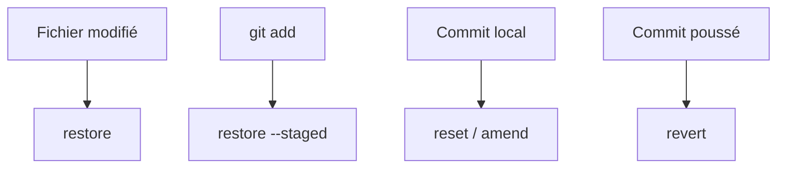

# Cours - Annuler et réparer dans Git

> [!abstract] Objectifs
> - Choisir la bonne commande selon ce qu'on veut défaire
> - Mettre un travail de côté
> - Mettre sa branche à jour par rebase
> - Retrouver un état perdu avec reflog

**Prérequis :** [[Cours - Travailler avec un dépôt distant]]

## 1. La question à se poser
« Est-ce déjà **poussé** ? » Si non, tu peux réécrire (reset, amend, rebase). Si oui, tu ajoutes un commit d'annulation (revert).

## 2. Schéma

## 3. Les cas courants
Voir le tableau de [[Annuler dans Git]] et la zone d'[[Index Git (staging)|index]].

## 4. Mettre de côté
[[Stash]] : `git stash push -m "…"`, `git stash pop`.

## 5. Rester à jour
[[Rebase]] : `git fetch && git rebase origin/main`, puis `git push --force-with-lease` sur **ta** branche uniquement.

## 6. Le filet de sécurité
`git reflog` liste tout ce que tu as fait : même après un mauvais `reset`, tu peux revenir en arrière tant que le commit a existé.

## Mise en pratique
- Fais l'[[Exercice - Réparer ses erreurs Git]].

> [!warning] Erreurs fréquentes
> - `git reset --hard` avec des modifications non commitées : perdues
> - Rebase ou amend sur une branche déjà partagée
> - Oublier un stash

## Résumé
En 3 phrases, avec mes mots.

## Concepts du cours
[[Annuler dans Git]] · [[Stash]] · [[Rebase]] · [[Index Git (staging)]]
