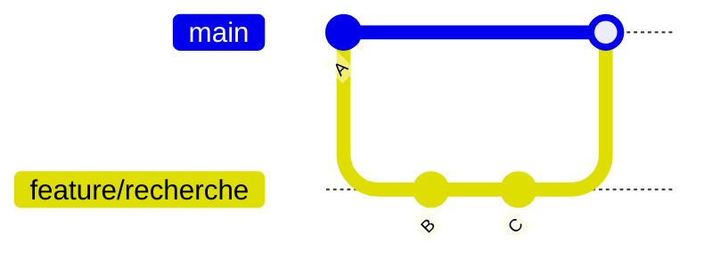

# Cours - Branches et fusion

> [!abstract] Objectifs
> - Comprendre ce qu'est une branche
> - Travailler sur une fonctionnalité isolée
> - Fusionner et résoudre un conflit

**Prérequis :** [[Commit]] · [[Git]]

## 1. Une branche est un pointeur
Créer une [[Branche Git]] ne copie rien : c'est une étiquette posée sur un commit, qui avance quand tu commites.

## 2. Le workflow de base

```bash
git switch -c feature/recherche
# ... travail + commits ...
git switch main
git merge feature/recherche
git branch -d feature/recherche
```
Commandes : [[git switch]] · [[git branch]] · [[git merge]]

## 3. Fast-forward ou commit de fusion
Si `main` n'a pas bougé, Git avance simplement le pointeur ; sinon il crée un commit de fusion (voir [[Merge]]).

## 4. Le conflit
Quand les deux branches ont modifié les mêmes lignes, Git s'arrête et te demande de choisir : voir [[Conflit de merge]] et [[Erreur - CONFLICT lors d'un git merge]].

## Mise en pratique
- [[Exercice - Branches et merge avec Git]]

> [!warning] Erreurs fréquentes
> - Fusionner dans le mauvais sens (vérifier la branche courante avec `git status`)
> - Changer de branche avec des modifications non commitées

## Résumé
On développe chaque fonctionnalité sur sa branche, on revient sur `main`, on fusionne. Un conflit n'est pas une erreur : c'est Git qui demande un arbitrage.

## Concepts du cours
[[Branche Git]] · [[Merge]] · [[Conflit de merge]]
