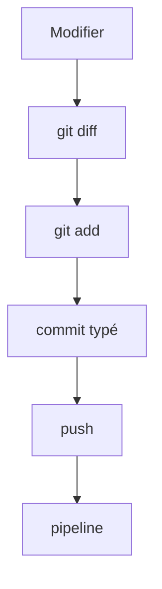

# Cours - Git propre dans un vrai projet

> [!abstract] Objectifs
> - Relire ses changements avant de committer
> - Écrire des messages de commit typés (`fix`, `ci`…)
> - Chercher dans le code avec `git grep`
> - Se placer sur une version avec les tags
> - Éviter les pièges Windows / Linux (droits, casse)

**Prérequis :** [[Cours - Git, les bases]] · [[Cours - Branches et fusion]]

## 1. Partir de la bonne version
Dans un projet repris (CVAT), on part du **tag de la version utilisée** ([[Tag Git]]), pas de la branche de développement. Les fichiers, les Dockerfile et la CI changent d'une version à l'autre : lire la doc ou le code d'une autre version mène à de fausses pistes.

## 2. Schéma : le cycle d'un changement

## 3. Relire avant de committer
`git diff` (non indexé) puis `git diff --staged` (ce qui va partir). On vérifie qu'il n'y a **que** le changement voulu : pas de fichier de test, pas de mot de passe, pas de fin de ligne modifiée partout.

## 4. Un changement = un commit = un pipeline
Un commit fait une seule chose, avec un message au format [[Convention de commit]] : `ci: …`, `fix: …`, `build: …`. Si la pipeline casse, on sait quel changement en est la cause.

## 5. Chercher dans le code
`git grep "CVAT_HOST"` cherche dans les fichiers suivis par Git, très vite, en ignorant `node_modules` et les fichiers non suivis. Indispensable pour trouver où une variable ou une image est utilisée.

## 6. Windows et Linux
Le droit d'exécution et la casse des noms ne se voient pas sous Windows mais cassent sous Linux. Voir [[Fichiers entre Windows et Linux]] (`git update-index --chmod=+x`, `git mv`).

## 7. Versions et journal
Les [[Tag Git|tags]] marquent les versions ; le [[Changelog]] explique ce qui change entre elles.

## Mise en pratique
- Avant ton prochain commit, lis `git diff --staged` en entier et retire tout ce qui n'est pas lié au changement.
- Avec `git grep`, trouve tous les fichiers de CVAT qui mentionnent `CVAT_HOST`, puis toutes les lignes `FROM`.
- Vérifie le droit d'exécution des scripts `.sh` du projet avec `git ls-files -s`.

> [!warning] Erreurs fréquentes
> - Committer « tout ce qui a changé » sans relire le diff
> - Mélanger un correctif de code et un changement de CI dans le même commit
> - Lire la documentation de la dernière version de CVAT alors que le projet utilise une version plus ancienne
> - Oublier `git push origin <tag>` : les tags ne partent pas tout seuls

## Résumé
En 3 phrases, avec mes mots.

## Concepts du cours
[[Convention de commit]] · [[Tag Git]] · [[Changelog]] · [[Fichiers entre Windows et Linux]]
