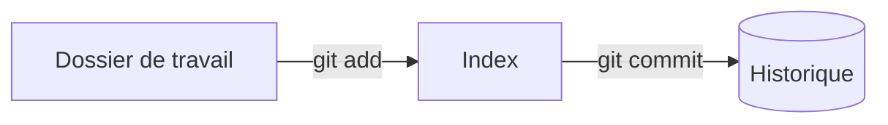

# Cours - Git, les bases

> [!abstract] Objectifs
> - Créer un dépôt
> - Comprendre les trois zones de Git
> - Faire des commits propres

**Prérequis :** [[Terminal]] · [[Système de fichiers]]

## 1. Pourquoi Git
Garder chaque version de ton travail, savoir ce qui a changé et pourquoi, revenir en arrière. Voir [[Git]].

## 2. Les trois zones


## 3. Le cycle de base
```bash
git init -b main          # une fois
git status                # où en suis-je ?
git add server.js         # je choisis
git commit -m "Ajoute le serveur"   # j'enregistre
git log --oneline         # je relis l'historique
```
Commandes : [[git init]] · [[git status]] · [[git add]] · [[git commit]]

## 4. Ce qu'il ne faut pas versionner
Créer un fichier `.gitignore` :
```text
node_modules/
.env
```

## Mise en pratique
- [[Fiche - Publier un dépôt sur GitHub]]
- [[Exercice - Branches et merge avec Git]] (étapes 1 à 3)

> [!warning] Erreurs fréquentes
> - Committer sans `git add` (« nothing to commit »)
> - Mettre des secrets (`.env`) dans l'historique
> - Des commits géants avec le message « update »

## Résumé
Git enregistre des photos ([[Commit|commits]]) de ce que tu as placé dans l'index. Petit commit, message clair, `git status` tout le temps.

## Concepts du cours
[[Git]] · [[Dépôt Git]] · [[Commit]]
