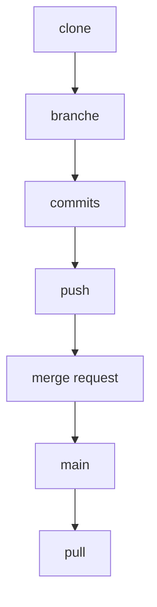

# Cours - Travailler avec un dépôt distant

> [!abstract] Objectifs
> - Cloner, récupérer et envoyer des changements
> - Résoudre un push refusé
> - Ouvrir et suivre une merge request

**Prérequis :** [[Cours - Git, les bases]] · [[Cours - Branches et fusion]]

## 1. Local et distant
Ton dépôt local est complet ; le [[Dépôt distant (remote)|remote]] (`origin`) sert à partager et à sauvegarder. Git ne synchronise **que quand tu le lui demandes**.

## 2. Schéma : le cycle d'équipe

## 3. Les commandes
- `git clone URL` : la première fois (HTTPS avec un jeton, ou SSH avec une [[Clé SSH]]).
- `git fetch` : voir ce qui a changé, sans risque.
- `git pull` : intégrer.
- `git push -u origin branche` : publier.

## 4. Quand le push est refusé
Quelqu'un a poussé avant toi : `git pull` (ou `git pull --rebase`), résous les conflits éventuels, repousse. Jamais `--force` sur une branche partagée.

## 5. La merge request
On ne pousse pas sur `main` directement : on ouvre une [[Merge request]], la CI tourne, un collègue relit, puis on fusionne.

## 6. Deux remotes
Pour un projet repris (CVAT) : `origin` = ton GitLab, `upstream` = le projet d'origine. Voir [[Dépôt upstream]].

## Mise en pratique
- Fais l'[[Exercice - Collaborer avec un dépôt distant]].

> [!warning] Erreurs fréquentes
> - Travailler directement sur `main`
> - Faire `git push --force` pour « régler » un rejet
> - Oublier `git pull` avant de commencer à travailler

## Résumé
En 3 phrases, avec mes mots.

## Concepts du cours
[[Dépôt distant (remote)]] · [[Merge request]] · [[Dépôt upstream]] · [[Clé SSH]]
