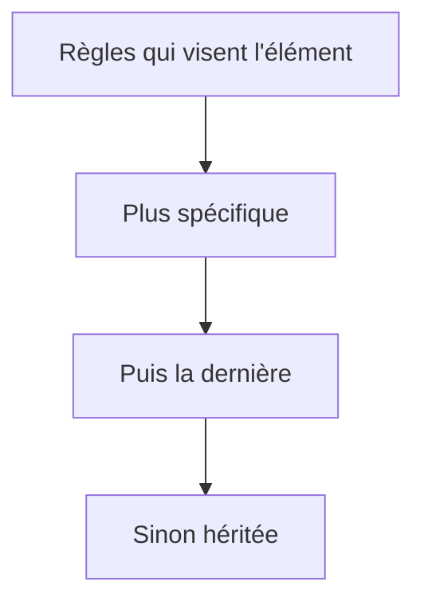

# Cours - CSS, mettre en forme

> [!abstract] Objectifs
> - Écrire des règles CSS et comprendre la cascade
> - Cibler précisément avec les sélecteurs
> - Maîtriser espacements et tailles avec le modèle de boîte

**Prérequis :** [[Cours - HTML, la structure d'une page]]

## 1. Une règle
`sélecteur { propriété: valeur; }`. Voir [[CSS]].

## 2. Schéma : quelle règle gagne ?

## 3. Cibler
[[Sélecteur CSS]] : balise, `.classe`, `#id`, descendants, états (`:hover`, `:focus`). Préfère les **classes** : faciles à réutiliser, spécificité faible.

## 4. Les boîtes
[[Modèle de boîte]] : contenu, `padding`, `border`, `margin`. Commence toujours par `box-sizing: border-box`.

## 5. Couleurs, textes, variables
`color`, `background`, `font-family`, `font-size` (en `rem`), `line-height`. Les **variables** `--nom` dans `:root` centralisent les couleurs (comme ton thème Obsidian).

## 6. Déboguer
F12 → onglet *Styles* : les règles appliquées, les règles écrasées (barrées), et la possibilité de tester une valeur en direct.

## Mise en pratique
- Fais l'[[Exercice - Mettre en forme une page avec CSS]].

> [!warning] Erreurs fréquentes
> - Utiliser des `id` pour le style : spécificité trop forte, difficile à surcharger
> - Abuser de `!important`
> - Oublier `box-sizing: border-box` et s'étonner des tailles

## Résumé
En 3 phrases, avec mes mots.

## Concepts du cours
[[CSS]] · [[Sélecteur CSS]] · [[Modèle de boîte]]
