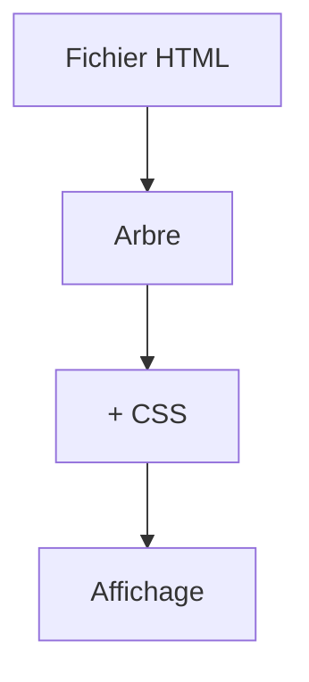

# Cours - HTML, la structure d'une page

> [!abstract] Objectifs
> - Écrire une page HTML valide et bien structurée
> - Utiliser les bons éléments selon le sens du contenu
> - Écrire un formulaire avec labels et validation
> - Vérifier l'accessibilité de base

**Prérequis :** [[Cours - Comment fonctionne le web]]

## 1. Ce que le navigateur reçoit
Quand tu ouvres une page, le serveur envoie un fichier [[HTML]]. Le navigateur le lit, construit un arbre d'éléments, télécharge les CSS, images et scripts qu'il référence, puis affiche.

## 2. Schéma

## 3. Le squelette
`<!doctype html>`, `<html lang="fr">`, `<head>` (encodage UTF-8, viewport, titre, styles), `<body>` (le contenu).

## 4. Les éléments
Des [[Élément et attribut HTML|éléments]] imbriqués, avec des attributs (`id`, `class`, `href`, `src`, `alt`). Choisis la balise selon le **sens** : `h1`…`h6` pour les titres, `p`, `ul`/`ol`, `a` pour aller ailleurs, `button` pour agir, `header`/`main`/`nav`/`footer` pour la structure.

## 5. Les formulaires
[[Formulaire HTML]] : `form`, `label` relié à chaque champ, `input` avec le bon `type`, validation native, mais toujours revérifiée côté serveur.

## 6. Pour tout le monde
[[Accessibilité web]] : bonne balise, `alt` sur les images, navigation au clavier, contraste.

## 7. Outils
Les outils de développement du navigateur (F12) : onglet *Éléments* pour voir et modifier l'arbre en direct. Voir [[Fiche - Utiliser les outils de développement du navigateur]].

## Mise en pratique
- Fais l'[[Exercice - Écrire une page HTML structurée et accessible]].

> [!warning] Erreurs fréquentes
> - Des `div` partout au lieu de balises qui ont un sens
> - Images sans `alt`, champs sans `label`
> - Un `div` cliquable à la place d'un `button`

## Résumé
En 3 phrases, avec mes mots.

## Concepts du cours
[[HTML]] · [[Élément et attribut HTML]] · [[Formulaire HTML]] · [[Accessibilité web]]
