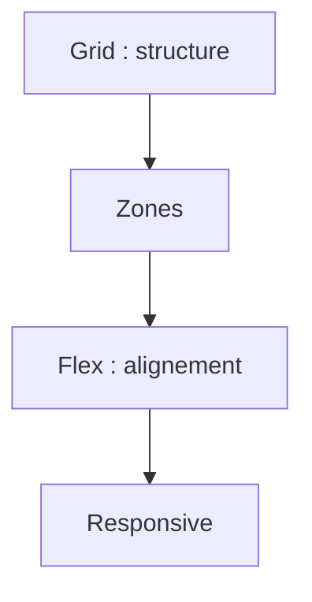

# Cours - Mise en page : Flexbox, Grid et responsive

> [!abstract] Objectifs
> - Aligner et répartir avec Flexbox
> - Structurer une page avec Grid
> - Adapter la page à toutes les tailles d'écran

**Prérequis :** [[Cours - CSS, mettre en forme]]

## 1. Deux outils
- [[Flexbox]] : une dimension. Barres, rangées de boutons, centrage.
- [[Grid CSS]] : deux dimensions. Structure de page, galeries.

## 2. Schéma

## 3. Flexbox
`display: flex`, `justify-content`, `align-items`, `gap`, `flex-wrap`, `flex: 1`.

## 4. Grid
`display: grid`, `grid-template-columns` (avec `fr`, `repeat`, `minmax`), `grid-template-areas`, `gap`.

## 5. Responsive
[[Responsive design]] : viewport, tailles fluides, media queries « mobile d'abord ». Teste avec le mode appareil de F12.

## Mise en pratique
- Fais l'[[Exercice - Mettre en page un tableau de bord responsive]].

> [!warning] Erreurs fréquentes
> - Positionner avec des marges négatives ou `position: absolute` ce que Flexbox ferait proprement
> - Largeurs fixes en `px` qui débordent sur mobile
> - Oublier la balise viewport

## Résumé
En 3 phrases, avec mes mots.

## Concepts du cours
[[Flexbox]] · [[Grid CSS]] · [[Responsive design]]
