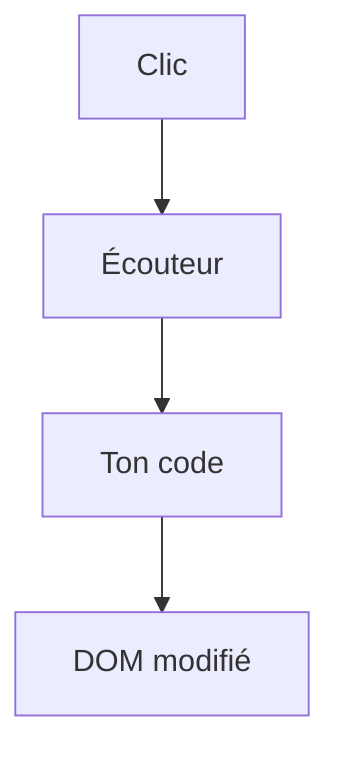

# Cours - JavaScript dans la page, DOM et événements

> [!abstract] Objectifs
> - Trouver et modifier des éléments de la page
> - Créer des éléments à partir de données
> - Réagir aux clics, saisies et envois de formulaire

**Prérequis :** [[Cours - Les bases de JavaScript]] · [[Cours - HTML, la structure d'une page]]

## 1. Le DOM
Le navigateur transforme le HTML en un arbre d'objets : le [[DOM]]. `document.querySelector` y trouve un élément avec un [[Sélecteur CSS]].

## 2. Schéma

## 3. Modifier
`textContent`, `classList.add/remove/toggle`, `setAttribute`, `createElement` puis `append`, `remove()`.

## 4. Réagir
[[Événement JavaScript]] : `addEventListener("click", …)`, `submit` avec `preventDefault()`, `input` pour la saisie en direct.

## 5. Pourquoi les frameworks
Faire tout ça à la main devient vite pénible quand la page grossit. [[React]], [[Vue.js]] et [[Angular]] le font pour toi : tu décris l'état, ils mettent le DOM à jour. Comprendre le DOM t'aide à comprendre ce qu'ils font.

## Mise en pratique
- Fais l'[[Exercice - Rendre une page interactive avec le DOM]].

> [!warning] Erreurs fréquentes
> - Script chargé avant le HTML (`null` au lieu de l'élément) : mets le `<script>` en bas ou ajoute `defer`
> - `innerHTML` avec du texte d'utilisateur (faille XSS)
> - Oublier `preventDefault()` sur `submit`

## Résumé
En 3 phrases, avec mes mots.

## Concepts du cours
[[DOM]] · [[Événement JavaScript]]
