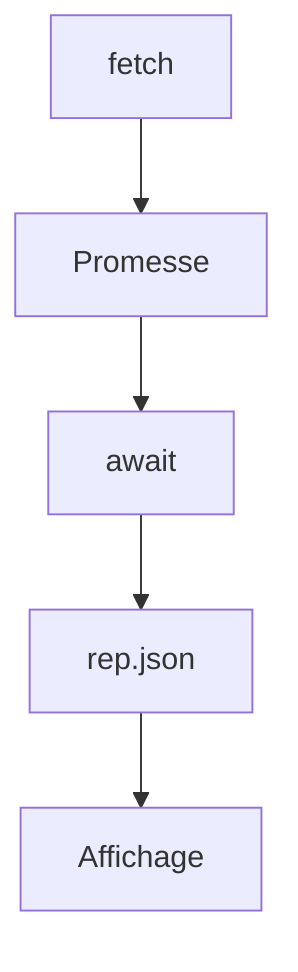

# Cours - L'asynchrone avec Promesses, async, await et fetch

> [!abstract] Objectifs
> - Comprendre pourquoi le code asynchrone s'exécute plus tard
> - Utiliser Promesses et async/await avec gestion d'erreurs
> - Appeler une API, vérifier le statut et lire le JSON
> - Lancer des appels en série ou en parallèle

**Prérequis :** [[Cours - JavaScript dans la page, DOM et événements]] · [[Cours - Comment fonctionne le web]]

## 1. Le problème
Un appel réseau prend du temps. JavaScript n'a qu'un fil : s'il attendait, la page serait figée. Il lance donc l'opération et continue ; la [[Boucle d'événements]] rappelle ton code quand la réponse arrive.

## 2. Schéma

## 3. Les Promesses
[[Asynchrone et Promesse]] : un résultat futur, avec `.then` et `.catch`.

## 4. async / await
[[async et await]] : la même chose, lisible de haut en bas, avec `try / catch`.

## 5. fetch
[[Appeler une API avec fetch]] : méthode, en-têtes, corps en [[JSON]] ; **toujours tester `rep.ok`**.

## 6. Série ou parallèle
`for … of` avec `await` : l'un après l'autre. `Promise.all` : tous en même temps.

## Mise en pratique
- Fais l'[[Exercice - Charger et afficher des données d'une API]].

> [!warning] Erreurs fréquentes
> - Oublier `await` (on affiche `[object Promise]`)
> - Ne pas tester `rep.ok`
> - `await` dans un `forEach` (ne attend pas) : utilise `for … of`

## Résumé
En 3 phrases, avec mes mots.

## Concepts du cours
[[Asynchrone et Promesse]] · [[async et await]] · [[Appeler une API avec fetch]] · [[Boucle d'événements]] · [[JSON]]
