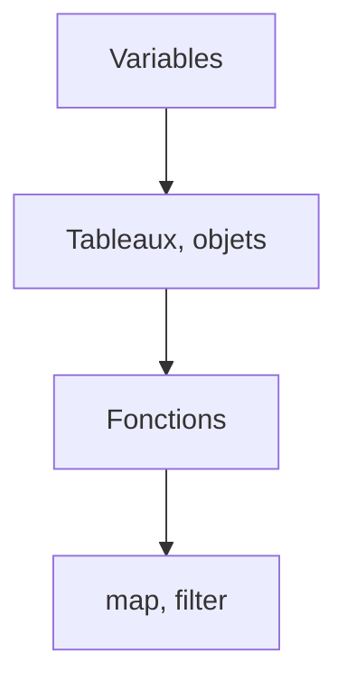

# Cours - Les bases de JavaScript

> [!abstract] Objectifs
> - Écrire et exécuter du JavaScript (console, fichier, page)
> - Utiliser const, let, les types et les comparaisons strictes
> - Manipuler tableaux et objets
> - Écrire des fonctions fléchées et les passer en callback
> - Transformer des données avec map, filter, reduce

**Prérequis :** [[Cours - HTML, la structure d'une page]] · [[Cours - Python, premiers pas]]

## 1. Où tourne JavaScript
Dans le navigateur (console F12, balise `<script>`) et dans le terminal avec [[Node.js]] (`node fichier.js`). C'est le même langage ; seuls les outils disponibles changent (le navigateur a `document`, Node a les fichiers).

## 2. Schéma

## 3. Variables et types
[[Variables et types en JavaScript]] : `const` par défaut, `let` si ça change, `===` toujours. Tu connais déjà l'idée grâce à Python ; seule la syntaxe change (accolades, points-virgules, `//` pour les commentaires).

| Python | JavaScript |
| --- | --- |
| `nom = "a"` | `const nom = "a";` |
| `f"Total {n}"` | `` `Total ${n}` `` |
| `True / False / None` | `true / false / null` |
| `if x:` + indentation | `if (x) { … }` |
| `for f in fichiers:` | `for (const f of fichiers) { … }` |
| `def f(x):` | `function f(x) { … }` ou `const f = (x) => …` |
| liste, dictionnaire | tableau, objet |

## 4. Tableaux et objets
[[Tableau et objet JavaScript]] : la forme de presque toutes les données, identique au [[JSON]].

## 5. Les fonctions sont des valeurs
[[Fonction fléchée et callback]] : on les range dans des variables et on les passe à d'autres fonctions.

## 6. Transformer des listes
[[Méthodes de tableau (map, filter, reduce)]] : à connaître par cœur, React s'en sert partout.

## Mise en pratique
- Fais l'[[Exercice - Manipuler des données en JavaScript]].

> [!warning] Erreurs fréquentes
> - `==` au lieu de `===`
> - Passer `f()` au lieu de `f` en callback
> - Croire que `const` rend un tableau non modifiable

## Résumé
En 3 phrases, avec mes mots.

## Concepts du cours
[[JavaScript]] · [[Variables et types en JavaScript]] · [[Tableau et objet JavaScript]] · [[Fonction fléchée et callback]] · [[Méthodes de tableau (map, filter, reduce)]]
