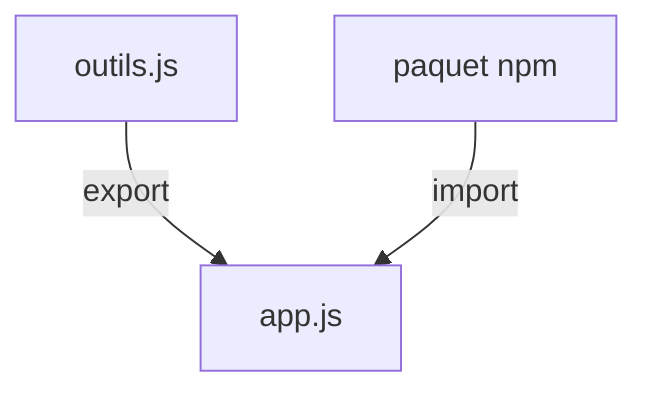

# Cours - Portée, closures et modules

> [!abstract] Objectifs
> - Savoir où une variable existe
> - Comprendre et utiliser une closure
> - Découper un programme en modules ES

**Prérequis :** [[Cours - Les bases de JavaScript]]

## 1. Où vit une variable
[[Portée et closure|La portée]] : une variable n'existe que dans son bloc `{ }` ou sa fonction. Moins une variable est visible, moins elle crée de bugs.

## 2. Les closures
Une fonction garde accès aux variables de l'endroit où elle a été créée. C'est ce qui fait marcher les gestionnaires d'événements et les hooks React.

## 3. Schéma

## 4. Les modules
[[Module JavaScript (import et export)]] : un fichier par responsabilité, `export` ce qu'on partage, `import` ce qu'on utilise. Tu rencontreras aussi l'ancien `require()` de Node (CommonJS).

## Mise en pratique
- Fais l'[[Exercice - Découper un programme JavaScript en modules]].

> [!warning] Erreurs fréquentes
> - Variable globale utilisée partout
> - Mélanger `import` et `require`
> - Oublier l'extension `.js` dans un import pour le navigateur

## Résumé
En 3 phrases, avec mes mots.

## Concepts du cours
[[Portée et closure]] · [[Module JavaScript (import et export)]]
