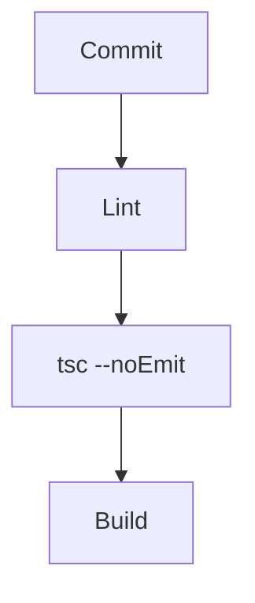

# Cours - Génériques et configuration du compilateur

> [!abstract] Objectifs
> - Lire et écrire des types génériques
> - Configurer un projet TypeScript avec tsconfig.json
> - Vérifier les types dans la CI

**Prérequis :** [[Cours - TypeScript, du JavaScript typé]]

## 1. Les génériques
[[Générique TypeScript]] : `Array<T>`, `Promise<T>`, `ReponsePage<T>`. Un trou dans le type, rempli à l'usage. Tu les liras surtout dans les bibliothèques et les frameworks.

## 2. Le compilateur
[[Compilation TypeScript (tsc et tsconfig)]] : `tsconfig.json` fixe les règles (`strict: true`), `tsc` compile, `tsc --noEmit` vérifie.

## 3. Schéma

## 4. Dans les frameworks
Angular, Vite (React, Vue) compilent pour toi. Les erreurs de type s'affichent dans l'éditeur et au build.

## Mise en pratique
- Fais l'[[Exercice - Configurer un projet TypeScript]].

> [!warning] Erreurs fréquentes
> - Désactiver `strict` pour aller plus vite
> - Oublier `tsc --noEmit` : Vite ne vérifie pas les types

## Résumé
En 3 phrases, avec mes mots.

## Concepts du cours
[[Générique TypeScript]] · [[Compilation TypeScript (tsc et tsconfig)]]
