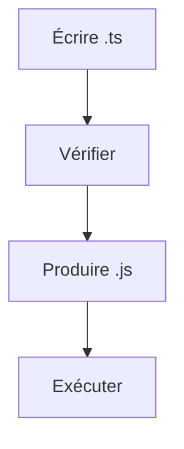

# Cours - TypeScript, du JavaScript typé

> [!abstract] Objectifs
> - Comprendre ce que TypeScript vérifie et quand
> - Typer variables, fonctions et objets
> - Décrire des cas multiples avec les unions et les affiner

**Prérequis :** [[Cours - Les bases de JavaScript]] · [[Cours - L'asynchrone avec Promesses, async, await et fetch]]

## 1. L'idée
[[TypeScript]] ajoute des types au JavaScript. Le compilateur vérifie **avant** l'exécution, puis retire les types. Le programme qui tourne est du JavaScript normal.

## 2. Schéma

## 3. Annoter
`nom: string`, `ages: number[]`, `function f(x: number): string`. Laisse l'**inférence** faire quand le type est évident.

## 4. Décrire ses données
[[Type et interface TypeScript]] : une `interface` par forme d'objet (une tâche, une annotation, une réponse d'API).

## 5. Plusieurs cas
[[Union et type littéral]] : `"ok" | "erreur"`, `string | null`, puis un `if` qui affine le type.

## 6. La limite
Les types disparaissent à l'exécution : les données qui viennent de l'extérieur (API, formulaire, fichier) doivent être vérifiées par le code.

## Mise en pratique
- Fais l'[[Exercice - Typer un petit programme en TypeScript]].

> [!warning] Erreurs fréquentes
> - Mettre `any` partout pour faire taire les erreurs
> - Croire que TypeScript vérifie les réponses d'API
> - Annoter ce qui est déjà inféré (code lourd pour rien)

## Résumé
En 3 phrases, avec mes mots.

## Concepts du cours
[[TypeScript]] · [[Type et interface TypeScript]] · [[Union et type littéral]]
