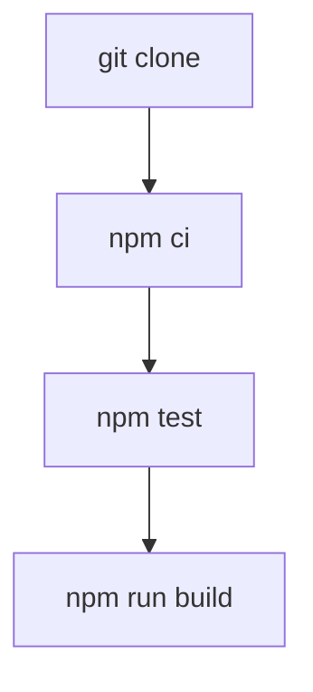

# Cours - Gérer un projet avec npm

> [!abstract] Objectifs
> - Lire et écrire un package.json
> - Installer, mettre à jour et auditer les dépendances
> - Comprendre les plages de versions et le lock

**Prérequis :** [[Cours - Node.js, JavaScript hors du navigateur]]

## 1. Le projet décrit par un fichier
[[package.json]] : nom, version, `scripts`, `dependencies`, `devDependencies`.

## 2. Installer
[[npm]] : `npm install` en développement, `npm ci` en CI et dans Docker. `node_modules` n'est jamais versionné, le lock l'est toujours.

## 3. Schéma

## 4. Les versions
[[Version sémantique (semver)]] : `^` accepte mineures et correctifs ; une majeure se lit (notes de version) avant de l'adopter.

## 5. Sécurité
`npm audit` liste les failles connues. Chaque dépendance est du code d'un inconnu qui tourne chez toi : n'en ajoute pas pour trois lignes.

## Mise en pratique
- Fais l'[[Exercice - Gérer les dépendances d'un projet npm]].

> [!warning] Erreurs fréquentes
> - Versionner `node_modules`
> - Supprimer le lock pour « réparer » une installation
> - Mettre une outil de test dans `dependencies` au lieu de `devDependencies`

## Résumé
En 3 phrases, avec mes mots.

## Concepts du cours
[[npm]] · [[package.json]] · [[Version sémantique (semver)]]
