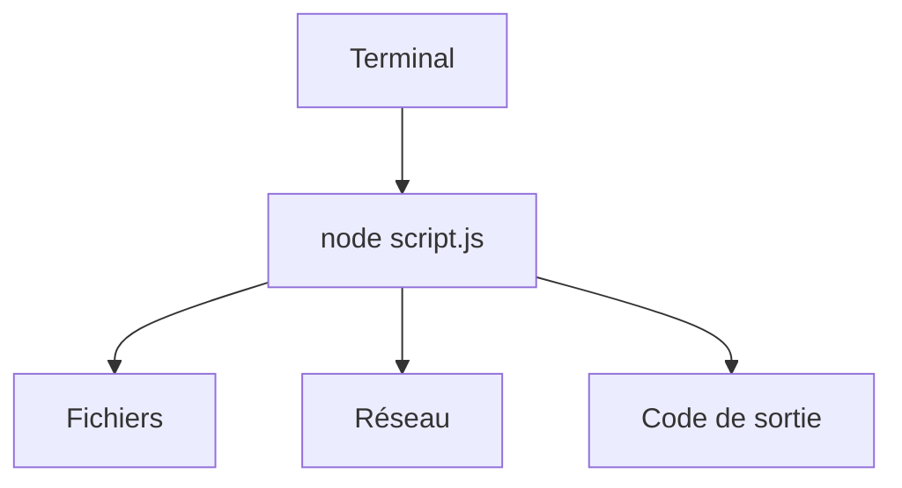

# Cours - Node.js, JavaScript hors du navigateur

> [!abstract] Objectifs
> - Installer et choisir sa version de Node
> - Écrire un script Node qui lit des arguments et des fichiers
> - Comprendre pourquoi Node gère beaucoup de requêtes avec un seul fil

**Prérequis :** [[Cours - L'asynchrone avec Promesses, async, await et fetch]] · [[Cours - Portée, closures et modules]]

## 1. Ce qu'est Node
[[Node.js]] : le moteur JavaScript de Chrome (V8), sorti du navigateur, avec des modules pour les fichiers, le réseau, les processus. Pas de `document` ni de `window`.

## 2. Installer la bonne version
[[Gestionnaire de versions de Node (nvm)]] : une version par projet, fixée dans `.nvmrc`. Vérifie avec `node -v`.

## 3. Schéma

## 4. Un script utile
[[Fichiers et chemins avec Node (fs et path)]] : `process.argv`, `fs/promises`, `path.join`, `process.exit(1)` en cas d'erreur.

## 5. Un seul fil, beaucoup de clients
La [[Boucle d'événements]] : tant que ton code ne fait pas de gros calcul synchrone, Node sert des milliers de requêtes en parallèle. C'est pour ça qu'il est populaire pour les API.

## Mise en pratique
- Fais l'[[Exercice - Écrire un outil en ligne de commande avec Node]].

> [!warning] Erreurs fréquentes
> - Utiliser `readFileSync` dans un serveur (bloque tout le monde)
> - Chemins relatifs qui dépendent du dossier courant
> - Installer Node avec apt et nvm en même temps

## Résumé
En 3 phrases, avec mes mots.

## Concepts du cours
[[Node.js]] · [[Fichiers et chemins avec Node (fs et path)]] · [[Boucle d'événements]] · [[Gestionnaire de versions de Node (nvm)]]
