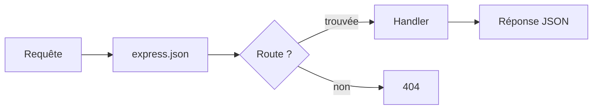

# Cours - Construire une API REST avec Express

> [!abstract] Objectifs
> - Démarrer un serveur Express
> - Écrire les cinq endpoints CRUD d'une ressource
> - Comprendre le rôle des middlewares

**Prérequis :** [[Node.js]] · [[npm]] · [[HTTP]] · [[JSON]]

## 1. Le plan
Une ressource `notes`, cinq [[Endpoint|endpoints]] suivant les conventions [[API REST]] :

| Méthode | Route | Rôle |
| --- | --- | --- |
| GET | `/notes` | Lister |
| GET | `/notes/:id` | Lire une note |
| POST | `/notes` | Créer |
| PATCH | `/notes/:id` | Modifier |
| DELETE | `/notes/:id` | Supprimer |

## 2. Installer
```bash
mkdir api-notes && cd api-notes
npm init -y
npm install express
```

## 3. Le serveur minimal
```js
const express = require('express');
const app = express();
app.use(express.json());           // middleware : lit le JSON du corps

app.get('/health', (req, res) => res.json({ ok: true }));

app.listen(3000, () => console.log('http://localhost:3000'));
```

## 4. Le trajet d'une requête

Chaque `app.use()` ajoute un [[Middleware]] ; ils s'exécutent dans l'ordre de déclaration.

## 5. Lire les entrées
- `req.params.id` — paramètre de route (`/notes/:id`)
- `req.query` — paramètres d'URL (`?done=true`)
- `req.body` — corps JSON (grâce à `express.json()`)

## 6. Répondre correctement
`res.status(201).json(note)` après une création, `res.status(404).json({ error: 'Note introuvable' })` si l'id n'existe pas, `res.sendStatus(204)` après une suppression.

## Mise en pratique
- [[Exercice - Créer une API REST avec Express]]
- [[Projet - API Notes]]

> [!warning] Erreurs fréquentes
> - Oublier `express.json()` → `req.body` vaut `undefined`
> - `req.params.id` est une **chaîne** : comparer avec `Number(req.params.id)`
> - Port déjà utilisé : [[Erreur - EADDRINUSE port déjà utilisé]]

## Résumé
Express associe des couples méthode + route à des fonctions. Les middlewares préparent la requête, les handlers répondent en JSON avec le bon code de statut.

## Concepts du cours
[[API REST]] · [[Endpoint]] · [[Express]] · [[Middleware]] · [[JSON]]
