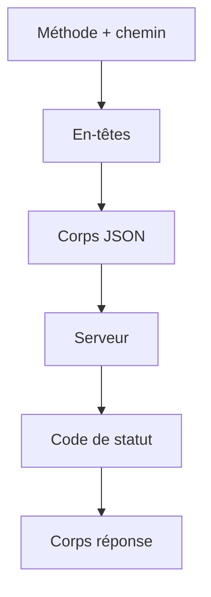

# Cours - Qu'est-ce qu'une API et comment HTTP la porte

> [!abstract] Objectifs
> - Expliquer ce qu'est une API et un endpoint
> - Choisir la bonne méthode HTTP
> - Lire un code de statut et savoir qui est en tort
> - Lire et envoyer des en-têtes

**Prérequis :** [[Cours - Comment fonctionne le web]] · [[Cours - L'asynchrone avec Promesses, async, await et fetch]]

## 1. Un contrat entre programmes
Une [[API]] dit : « envoie-moi ceci, je te réponds cela ». Le client n'a pas besoin de connaître le code du serveur.

## 2. Schéma d'un échange

## 3. Les endpoints
[[Endpoint]] : `GET /taches`, `POST /taches`, `GET /taches/12`. Paramètres de chemin, de requête, corps.

## 4. Les méthodes
[[Méthode HTTP]] : GET lit, POST crée, PUT remplace, PATCH modifie, DELETE supprime.

## 5. Les codes de statut
[[Code de statut HTTP]] : 2xx ça va, 4xx c'est toi, 5xx c'est le serveur.

## 6. Les en-têtes
[[En-tête HTTP]] : `Content-Type`, `Authorization`, `Accept`, `Set-Cookie`.

## 7. Les outils
`curl -i` et `curl -v` dans le terminal, l'onglet *Réseau* du navigateur, et la documentation [[OpenAPI]] (souvent sur `/api/docs`).

## Mise en pratique
- Fais l'[[Exercice - Explorer une API avec curl]].

> [!warning] Erreurs fréquentes
> - Confondre 401 et 403
> - Oublier `Content-Type` en envoyant du JSON
> - Un GET qui modifie des données

## Résumé
En 3 phrases, avec mes mots.

## Concepts du cours
[[API]] · [[Endpoint]] · [[Méthode HTTP]] · [[Code de statut HTTP]] · [[En-tête HTTP]]
