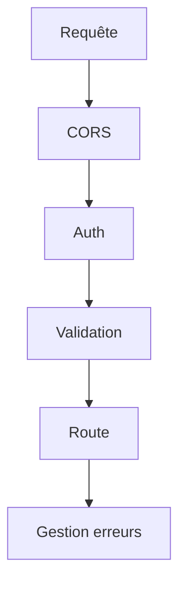

# Cours - Une API robuste, validation, erreurs et CORS

> [!abstract] Objectifs
> - Valider toutes les entrées avec un schéma
> - Renvoyer des erreurs cohérentes avec le bon code
> - Comprendre et régler une erreur CORS

**Prérequis :** [[Cours - Construire une API REST avec Express]]

## 1. Ne jamais faire confiance
[[Validation des données]] : un schéma (Zod, Pydantic) par entrée ; 400 avec le détail si ça ne passe pas.

## 2. Schéma

## 3. Échouer proprement
[[Gestion des erreurs d'une API]] : le bon code, une forme d'erreur unique, le détail dans les logs.

## 4. Le navigateur et les autres origines
[[CORS]] : réglé **sur le serveur** (ou évité avec un proxy), jamais en désactivant la sécurité du navigateur.

## Mise en pratique
- Fais l'[[Exercice - Rendre une API robuste]].

> [!warning] Erreurs fréquentes
> - Valider seulement côté navigateur
> - Renvoyer la trace d'erreur au client
> - `Access-Control-Allow-Origin: *` avec des cookies

## Résumé
En 3 phrases, avec mes mots.

## Concepts du cours
[[Validation des données]] · [[Gestion des erreurs d'une API]] · [[CORS]]
