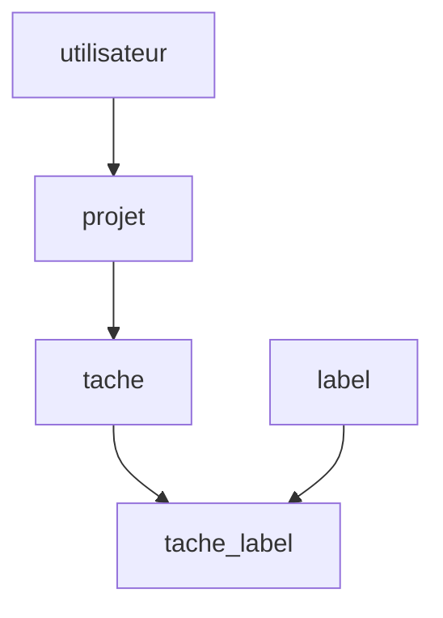

# Cours - Concevoir des tables reliées

> [!abstract] Objectifs
> - Découper des données en tables sans répétition
> - Poser clés primaires et étrangères
> - Combiner les tables avec des jointures

**Prérequis :** [[Cours - Construire une API REST avec Express]]

## 1. Pourquoi plusieurs tables
Dans une [[Base de données relationnelle]], on range chaque information une seule fois. Le nom d'un projet n'est pas recopié dans chaque tâche : la tâche **pointe** vers le projet.

## 2. Schéma

## 3. Les clés
[[Clé primaire et clé étrangère]] : l'identifiant unique, et la colonne qui relie. Relation 1-N avec une clé étrangère ; N-N avec une table de liaison.

## 4. Réunir
[[Jointure SQL]] : `JOIN` pour ce qui correspond, `LEFT JOIN` pour tout garder à gauche, puis `GROUP BY` pour compter.

## 5. Pratiquer sans rien installer
La [[Fiche - Lancer PostgreSQL avec Docker]] te donne une base en une commande, et [[psql]] pour lui parler.

## Mise en pratique
- Fais l'[[Exercice - Modéliser et interroger une base reliée]].

> [!warning] Erreurs fréquentes
> - Recopier les mêmes informations dans plusieurs tables
> - Oublier la clé étrangère (rien ne protège la cohérence)
> - `INNER JOIN` qui fait disparaître des lignes

## Résumé
En 3 phrases, avec mes mots.

## Concepts du cours
[[Clé primaire et clé étrangère]] · [[Jointure SQL]]
