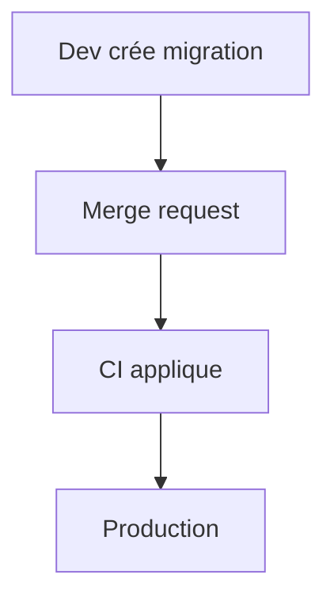

# Cours - La base depuis le code, ORM, migrations et NoSQL

> [!abstract] Objectifs
> - Utiliser un ORM sans perdre de vue le SQL
> - Faire évoluer un schéma avec des migrations
> - Savoir quand une base NoSQL est adaptée

**Prérequis :** [[Cours - Performance et cohérence, index et transactions]]

## 1. Les objets et les tables
[[ORM]] : Prisma, SQLAlchemy, Django. Pratique, mais lis le SQL produit et méfie-toi du problème N+1.

## 2. Faire évoluer le schéma
[[Migration de base de données]] : un fichier par changement, versionné, appliqué dans l'ordre partout.

## 3. Schéma

## 4. Autre chose que des tables
[[Base NoSQL]] : Redis pour le cache et les sessions, MongoDB pour des documents. CVAT combine PostgreSQL et Redis.

## Mise en pratique
- Fais l'[[Exercice - Faire évoluer une base avec un ORM et des migrations]].

> [!warning] Erreurs fréquentes
> - Modifier une migration déjà appliquée
> - Croire qu'un ORM dispense de SQL
> - Choisir NoSQL pour des données très reliées

## Résumé
En 3 phrases, avec mes mots.

## Concepts du cours
[[ORM]] · [[Migration de base de données]] · [[Base NoSQL]]
