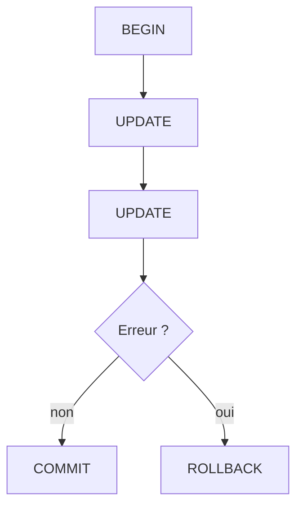

# Cours - Performance et cohérence, index et transactions

> [!abstract] Objectifs
> - Lire un plan d'exécution et poser un index utile
> - Grouper des opérations dans une transaction

**Prérequis :** [[Cours - Concevoir des tables reliées]]

## 1. Aller vite
[[Index de base de données]] : un sommaire trié. `EXPLAIN ANALYZE` montre si la base l'utilise.

## 2. Schéma

## 3. Rester cohérent
[[Transaction]] : tout ou rien. ACID.

## 4. Le bon réflexe
Mesurer d'abord (`EXPLAIN ANALYZE`), indexer ensuite, et seulement les colonnes réellement filtrées.

## Mise en pratique
- Pour chaque notion du cours : les **exercices visuels** de sa fiche (section 3), puis le fil rouge de son niveau ([[Niveaux]]).

> [!warning] Erreurs fréquentes
> - Indexer toutes les colonnes
> - Oublier la transaction pour un import en plusieurs étapes

## Résumé
Pas de résumé à écrire : si tu veux, fais un dessin Excalidraw qui relie les notions ci-dessous.

## Concepts du cours
[[Index de base de données]] · [[Transaction]]
