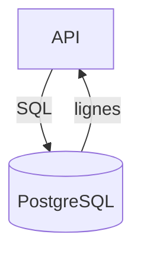

# Cours - SQL, lire et écrire des données

> [!abstract] Objectifs
> - Comprendre ce qu'est une base relationnelle
> - Lire avec SELECT, filtrer, trier, compter
> - Écrire avec INSERT, UPDATE, DELETE sans casse

**Prérequis :** [[Cours - Construire une API REST avec Express]]

## 1. Pourquoi une base
Un fichier JSON suffit pour dix notes. Pour des milliers de lignes, plusieurs utilisateurs en même temps et des données qui doivent rester cohérentes, il faut une [[Base de données relationnelle]] : PostgreSQL (CVAT), MySQL, SQLite.

## 2. Schéma

## 3. Des tables
Une table = des colonnes typées et des lignes. Chaque ligne a un identifiant unique.

## 4. Lire
[[SQL]] : `SELECT colonnes FROM table WHERE condition ORDER BY … LIMIT …`. Agréger avec `COUNT`, `SUM`, `AVG` et `GROUP BY`.

## 5. Écrire
[[INSERT]], [[UPDATE]], [[DELETE]]. Réflexe vital : écrire d'abord le `SELECT` avec le même `WHERE` pour voir ce qui sera touché.

## 6. L'outil
[[psql]] dans le terminal, ou un client graphique (DBeaver). La [[Fiche - Lancer PostgreSQL avec Docker]] te donne une base en une commande.

## Mise en pratique
- Fais l'[[Exercice - Premières requêtes SQL]].

> [!warning] Erreurs fréquentes
> - `UPDATE` ou `DELETE` sans `WHERE`
> - Guillemets doubles pour les chaînes (en SQL : apostrophes)
> - Oublier le `;` dans psql

## Résumé
En 3 phrases, avec mes mots.

## Concepts du cours
[[Base de données relationnelle]] · [[SQL]]
