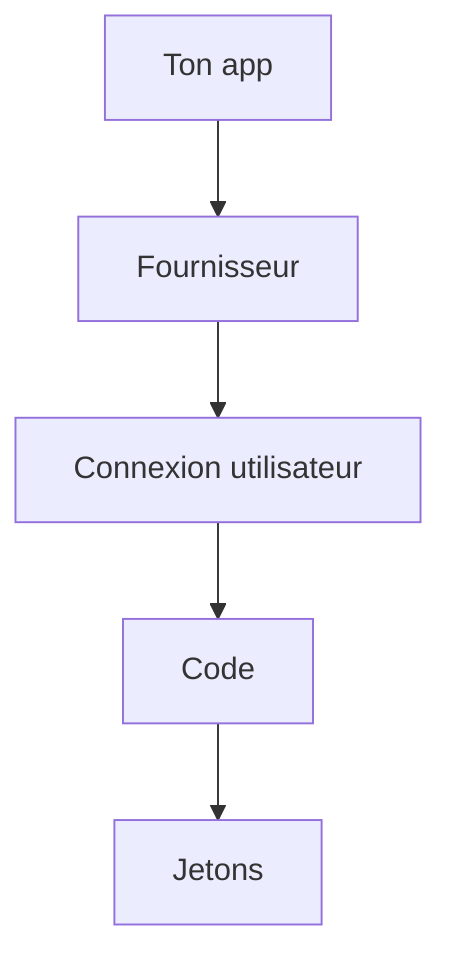

# Cours - Droits et connexion déléguée, rôles, OAuth 2 et OpenID Connect

> [!abstract] Objectifs
> - Contrôler les droits par rôle et par propriété
> - Comprendre le flux OAuth 2 avec code d'autorisation
> - Savoir ce qu'ajoute OpenID Connect

**Prérequis :** [[Cours - S'authentifier, mots de passe, sessions et jetons]]

## 1. Le droit de faire
[[Autorisation et rôles]] : par rôle, et par propriété de la ressource, toujours côté serveur. Moindre privilège partout (utilisateurs, jetons de CI, conteneurs).

## 2. Déléguer la connexion
[[OAuth 2 et OpenID Connect]] : l'utilisateur se connecte chez le fournisseur ; ton application reçoit un code, puis des jetons.

## 3. Schéma

## 4. Dans la vraie vie
« Se connecter avec GitLab », SSO d'entreprise avec Keycloak, jetons d'accès personnels avec des *scopes* limités.

## Mise en pratique
- Fais l'[[Exercice - Rôles et connexion OAuth]].

> [!warning] Erreurs fréquentes
> - Cacher un bouton au lieu de vérifier sur le serveur
> - Oublier la vérification de propriété
> - Ignorer le paramètre `state`

## Résumé
En 3 phrases, avec mes mots.

## Concepts du cours
[[Autorisation et rôles]] · [[OAuth 2 et OpenID Connect]]
