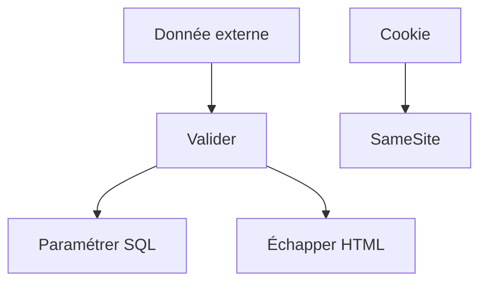

# Cours - Les failles web les plus courantes

> [!abstract] Objectifs
> - Reconnaître et corriger une injection SQL
> - Afficher du contenu sans XSS
> - Se protéger du CSRF
> - Garder les secrets hors du code et de Git

**Prérequis :** [[Cours - S'authentifier, mots de passe, sessions et jetons]] · [[Cours - JavaScript dans la page, DOM et événements]]

## 1. Une seule idée derrière beaucoup de failles
Une donnée de l'extérieur finit par être traitée comme du **code** : par la base ([[Injection SQL]]), par le navigateur ([[XSS]]), ou une action est déclenchée à l'insu de l'utilisateur ([[CSRF]]).

## 2. Schéma

## 3. Les secrets
[[Secret et fichier .env]] : dans l'environnement, jamais dans Git ni dans l'image. Un secret qui a fui se **révoque**.

## 4. La référence
Le **Top 10 OWASP** liste les failles les plus fréquentes ; le contrôle d'accès cassé ([[Autorisation et rôles]]) est en tête.

## Mise en pratique
- Fais l'[[Exercice - Trouver et corriger des failles]].

> [!warning] Erreurs fréquentes
> - Concaténer des valeurs dans du SQL
> - `innerHTML` avec du contenu d'utilisateur
> - Un secret commité « juste pour tester »

## Résumé
En 3 phrases, avec mes mots.

## Concepts du cours
[[Injection SQL]] · [[XSS]] · [[CSRF]] · [[Secret et fichier .env]]
