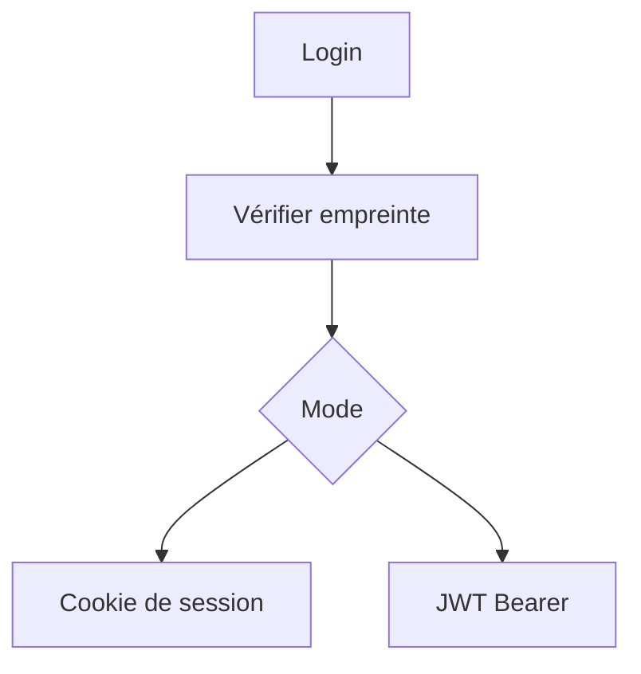

# Cours - S'authentifier, mots de passe, sessions et jetons

> [!abstract] Objectifs
> - Distinguer authentification et autorisation
> - Stocker un mot de passe correctement
> - Choisir entre session à cookie et JWT, et les configurer sans faille

**Prérequis :** [[Cours - Construire une API REST avec Express]] · [[Cours - SQL, lire et écrire des données]]

## 1. Qui es-tu ?
[[Authentification]] : prouver son identité une fois, puis être reconnu à chaque requête.

## 2. Le mot de passe
[[Hachage de mot de passe]] : argon2 ou bcrypt, jamais en clair, jamais MD5.

## 3. Schéma

## 4. Rester connecté
[[Session et cookie]] : l'état sur le serveur, un cookie `HttpOnly; Secure; SameSite`. Simple et révocable : idéal pour une application web.

## 5. Les jetons
[[JWT]] : l'état dans le jeton signé, court, dans `Authorization`. Pratique pour les API et les services.

## Mise en pratique
- Fais l'[[Exercice - Inscription, connexion et session]], puis l'[[Exercice - Protéger une route avec un JWT]].

> [!warning] Erreurs fréquentes
> - Stocker des mots de passe en clair ou en SHA-256
> - Mettre un JWT dans `localStorage` sans réfléchir au XSS
> - Utiliser `jwt.decode` au lieu de `jwt.verify`

## Résumé
En 3 phrases, avec mes mots.

## Concepts du cours
[[Authentification]] · [[Hachage de mot de passe]] · [[Session et cookie]] · [[JWT]]
