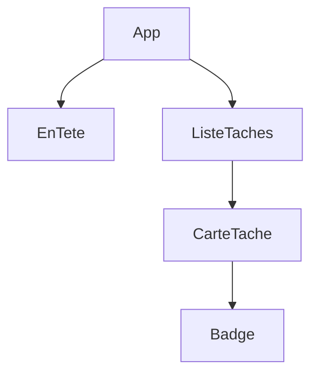

# Cours - Penser en composants

> [!abstract] Objectifs
> - Créer et lancer un projet React avec Vite
> - Découper une interface en composants
> - Passer des données par les props et remonter des événements
> - Afficher des listes avec des clés

**Prérequis :** [[Cours - JavaScript dans la page, DOM et événements]] · [[Cours - TypeScript, du JavaScript typé]]

## 1. Pourquoi React
Tu as fait une liste de tâches avec le [[DOM]] à la main : chaque modification demandait du code. [[React]] inverse la logique : tu décris l'écran selon les données.

## 2. Démarrer
[[Outil de build front (Vite)]] : `npm create vite@latest`, `npm run dev`, `npm run build`.

## 3. Schéma

## 4. Les composants
[[Composant React]] : une fonction, du JSX, une majuscule, un fichier.

## 5. Les props
[[Props React]] : les données descendent, les événements remontent par des fonctions.

## 6. Les listes
[[Liste et clé en React]] : `map` et une `key` stable.

## Mise en pratique
- Fais l'[[Exercice - Construire une interface en composants React]].

> [!warning] Erreurs fréquentes
> - `class` au lieu de `className`
> - Modifier une prop
> - `key={index}` dans une liste qui change

## Résumé
En 3 phrases, avec mes mots.

## Concepts du cours
[[React]] · [[Composant React]] · [[Props React]] · [[Liste et clé en React]] · [[Outil de build front (Vite)]]
