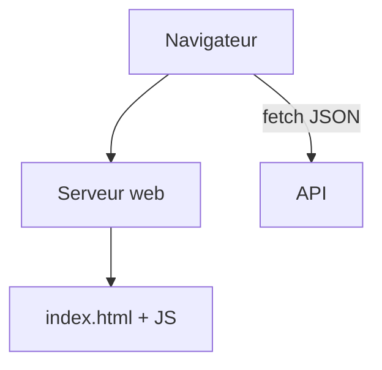

# Cours - Une application React complète

> [!abstract] Objectifs
> - Organiser une SPA avec un routeur
> - Brancher l'interface sur une API
> - Construire et servir l'application en production

**Prérequis :** [[Cours - État, effets et hooks]] · [[Cours - Construire une API REST avec Express]]

## 1. Une seule page
[[Application monopage et routage]] : un `index.html`, du JavaScript, et un routeur qui associe chaque adresse à un composant.

## 2. Schéma

## 3. Organisation des dossiers
`src/composants`, `src/pages`, `src/hooks`, `src/api` (les fonctions `fetch`), `src/types`.

## 4. Parler à l'API
Un module `api.ts` avec des fonctions typées ; le jeton dans `Authorization` ; les erreurs affichées à l'utilisateur. En développement, le **proxy de Vite** (`server.proxy`) évite les soucis de [[CORS]].

## 5. Mettre en production
`npm run build`, puis servir `dist/` avec Nginx (avec le repli vers `index.html`), souvent dans une image Docker multi-étapes.

## 6. Le lien avec CVAT
Le frontend de CVAT suit exactement ce schéma ; ajouter un bouton, c'est ajouter un composant qui appelle une API.

## Mise en pratique
- Fais l'[[Exercice - Ajouter un bouton qui appelle une API]].

> [!warning] Erreurs fréquentes
> - `<a href>` au lieu de `Link`
> - Oublier le repli vers `index.html` sur le serveur
> - Mettre un secret dans une variable `VITE_`

## Résumé
En 3 phrases, avec mes mots.

## Concepts du cours
[[Application monopage et routage]]
