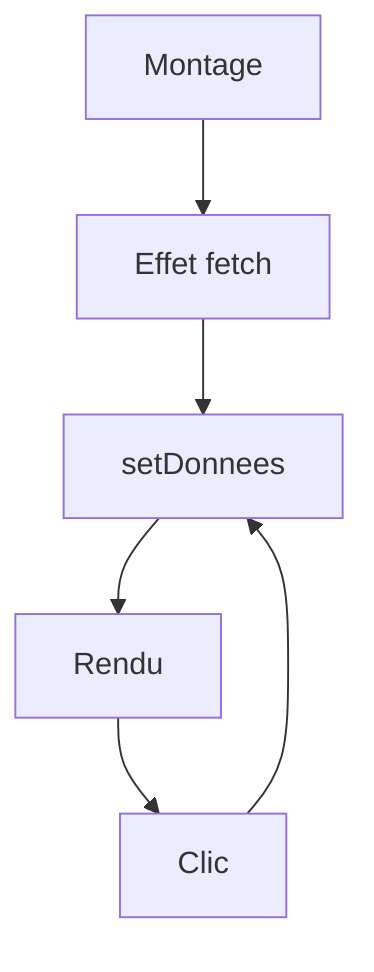

# Cours - État, effets et hooks

> [!abstract] Objectifs
> - Gérer l'état sans le modifier en place
> - Charger des données avec un effet correctement nettoyé
> - Respecter les règles des hooks et écrire un hook personnalisé

**Prérequis :** [[Cours - Penser en composants]] · [[Cours - L'asynchrone avec Promesses, async, await et fetch]]

## 1. Ce qui change
[[État et réactivité]] : une valeur et sa fonction de mise à jour. Toujours une **nouvelle** valeur.

## 2. Schéma

## 3. Parler à l'extérieur
[[Effet React (useEffect)]] : après le rendu, avec des dépendances et un nettoyage.

## 4. Réutiliser
[[Hook React]] : `useContext`, `useRef`, `useMemo`, et tes propres `useQuelqueChose`.

## Mise en pratique
- Pour chaque notion du cours : les **exercices visuels** de sa fiche (section 3), puis le fil rouge de son niveau ([[Niveaux]]).

> [!warning] Erreurs fréquentes
> - Modifier l'état en place
> - Effet sans dépendances (boucle infinie)
> - Hook dans un `if`

## Résumé
Pas de résumé à écrire : si tu veux, fais un dessin Excalidraw qui relie les notions ci-dessous.

## Concepts du cours
[[État et réactivité]] · [[Effet React (useEffect)]] · [[Hook React]]
