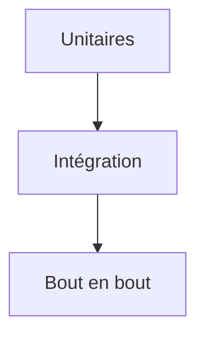

# Cours - Pourquoi et comment tester

> [!abstract] Objectifs
> - Comprendre la pyramide des tests
> - Écrire des tests unitaires utiles (normal, limite, erreur)
> - Utiliser Vitest et pytest

**Prérequis :** [[Cours - Installer des dépendances et tester]] · [[Cours - Les bases de JavaScript]]

## 1. Pourquoi
Un [[Test automatisé]] vérifie ton code à ta place, en secondes, à chaque modification et dans la CI.

## 2. Schéma

## 3. Le test unitaire
[[Test unitaire]] : une fonction, isolée ; préparer, agir, vérifier. Cas normal, cas limites, erreurs.

## 4. Les outils
[[pytest]] en Python, [[Vitest et Jest]] en JavaScript. Même logique : des fichiers de test, des assertions, un code de sortie.

## 5. Écrire du code testable
Des fonctions qui prennent leurs entrées en paramètres et renvoient un résultat. Si un test est difficile à écrire, c'est souvent le code qu'il faut simplifier.

## 6. Le réflexe bug
Avant de corriger un bug, écris le test qui le reproduit. Il échoue ; corrige ; il passe, et le bug ne reviendra pas sans qu'on le sache.

## Mise en pratique
- Fais l'[[Exercice - Écrire des tests unitaires et des doublures]].

> [!warning] Erreurs fréquentes
> - Tester l'implémentation au lieu du comportement
> - Tests qui dépendent les uns des autres
> - Oublier les cas d'erreur

## Résumé
En 3 phrases, avec mes mots.

## Concepts du cours
[[Test automatisé]] · [[Test unitaire]] · [[Vitest et Jest]] · [[pytest]]
