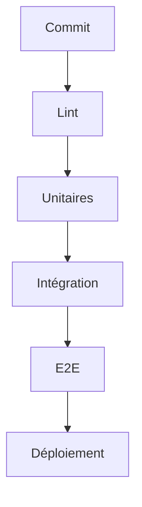

# Cours - Tester une application entière

> [!abstract] Objectifs
> - Isoler une dépendance avec une doublure
> - Tester une API avec sa base
> - Écrire un test de navigateur
> - Lire et utiliser la couverture

**Prérequis :** [[Cours - Pourquoi et comment tester]] · [[Cours - Construire une API REST avec Express]]

## 1. Remplacer ce qui gêne
[[Doublure de test (mock)]] : réseau, horloge, hasard. Seulement aux frontières.

## 2. Assembler
[[Test d'intégration]] : l'API avec une vraie base jetable (service PostgreSQL de la CI).

## 3. Schéma

## 4. Comme un utilisateur
[[Test de bout en bout]] : Playwright, peu de tests, les parcours essentiels.

## 5. Mesurer
[[Couverture de code]] : pour trouver les trous, pas comme un objectif en soi.

## Mise en pratique
- Fais l'[[Exercice - Tester une API et son interface]].

> [!warning] Erreurs fréquentes
> - Tout simuler
> - Des tests E2E pour tout
> - Viser 100 % de couverture à tout prix

## Résumé
En 3 phrases, avec mes mots.

## Concepts du cours
[[Doublure de test (mock)]] · [[Test d'intégration]] · [[Test de bout en bout]] · [[Couverture de code]]
