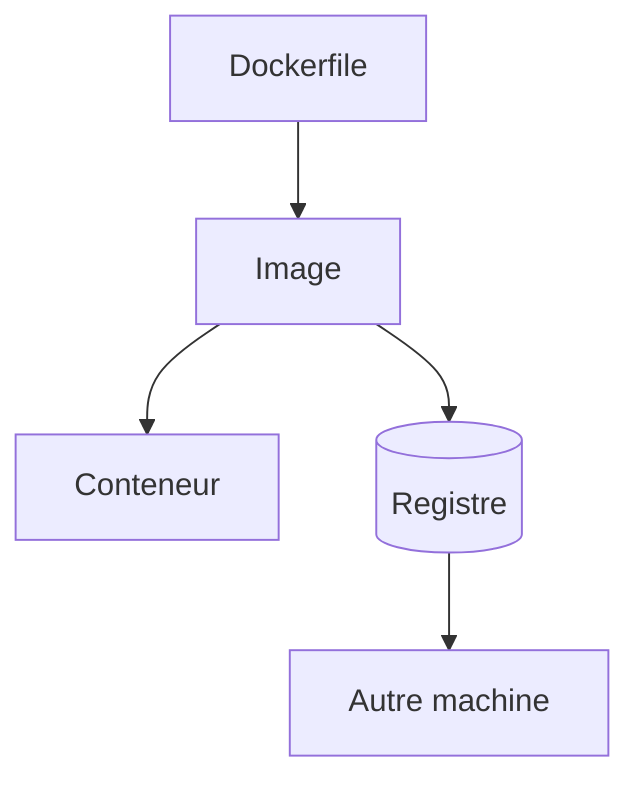

# Cours - Docker, les bases solides

> [!abstract] Objectifs
> - Expliquer client, démon, image, conteneur et registre, et comment ils s'enchaînent
> - Construire une image et comprendre son cache
> - Lancer, inspecter et nettoyer des conteneurs
> - Brancher des fichiers dans un conteneur
> - Lire un docker-compose.yml

**Prérequis :** [[Terminal]] · [[Cours - Ce que tout programme reçoit et renvoie]]

## 1. L'idée
[[Docker]] emballe une application avec tout son environnement. On écrit une recette ([[Dockerfile]]), on obtient un modèle figé ([[Image Docker]]), et on en lance des instances ([[Conteneur|conteneurs]]). Les images se rangent dans des [[Registre Docker|registres]].

## 2. Schéma


## 3. Qui fait le travail
La commande `docker` envoie des ordres au [[Démon Docker]]. C'est lui qui construit, télécharge et lance. Si le démon ne tourne pas, rien ne marche ; c'est aussi lui qui doit connaître le proxy ou le miroir de l'entreprise.

## 4. Construire une image
Chaque instruction du Dockerfile ajoute une couche. Docker met les couches en cache : mets ce qui change rarement (dépendances) **avant** ce qui change souvent (code). Une image construite `FROM` une autre est une **image dérivée**.

## 5. Lancer un conteneur
Un conteneur est un processus isolé. Il s'arrête quand son processus principal s'arrête, et renvoie son [[Code de sortie]]. Il est jetable : ce qui doit rester va dans un [[Volume Docker]].

## 6. Brancher des fichiers
`-v dossier_hôte:/chemin_conteneur` rend un dossier de ta machine visible dans le conteneur. C'est ainsi qu'un script dans Docker traite tes fichiers.

## 7. Plusieurs conteneurs ensemble
[[Docker Compose]] décrit les services d'une application dans un fichier [[YAML]] et les lance ensemble, sur un réseau où ils se joignent par leur nom.

## 8. Le ménage
```bash
docker ps -a              # tous les conteneurs
docker image ls           # toutes les images
docker system df          # place occupée
docker system prune       # supprime ce qui ne sert plus (demande confirmation)
```

## Mise en pratique
- Explique à voix haute, sans notes, la différence entre image, conteneur et registre.
- Construis une petite image Python, lance-la deux fois avec des arguments différents.
- Lis le `docker-compose.yml` de CVAT et dessine (sur papier) les services et leurs liens.

> [!warning] Erreurs fréquentes
> - Modifier un fichier dans un conteneur en pensant modifier l'image
> - Oublier `--rm` et accumuler des dizaines de conteneurs arrêtés
> - Mettre `COPY . .` avant `pip install` : tout le cache saute à chaque modification du code
> - Utiliser le tag `latest` en pensant avoir une version fixe

## Résumé
En 3 phrases, avec mes mots.

## Concepts du cours
[[Docker]] · [[Démon Docker]] · [[Image Docker]] · [[Dockerfile]] · [[Conteneur]] · [[Volume Docker]] · [[Registre Docker]] · [[Docker Compose]]
