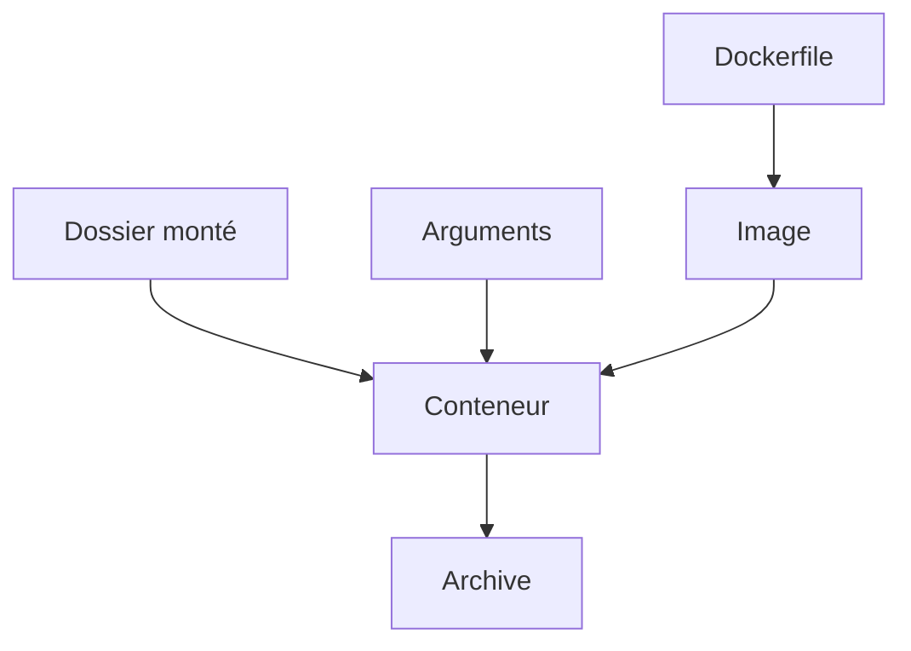

# Cours - Faire tourner un script Python dans Docker

> [!abstract] Objectifs
> - Écrire le Dockerfile d'un script Python
> - Lui passer des fichiers, des arguments et des variables
> - Lire ses logs et son code de sortie
> - Le tester dans son image

**Prérequis :** [[Cours - Docker, les bases solides]] · [[Cours - Manipuler des fichiers et des archives]] · [[Cours - Installer des dépendances et tester]]

## 1. Ce qui change par rapport au poste
Sur ton poste, le script voit tes dossiers et ton Python. Dans un conteneur, il ne voit **que** ce que l'image contient et ce que tu montes. Trois questions à se poser :
1. Qu'est-ce qui doit être **dans l'image** ? (Python, paquets, le script)
2. Qu'est-ce qui arrive **au lancement** ? (fichiers à traiter, paramètres)
3. Où va **le résultat** ? (un dossier monté)

## 2. Schéma

## 3. Le Dockerfile
Image de base `python:3.12-slim`, `requirements.txt` copié et installé d'abord (cache), puis le script, puis `ENTRYPOINT`. Voir [[Python dans Docker]].

## 4. Les entrées
- Fichiers : `-v` ([[Volume Docker]]), chemins **Linux** dans le conteneur (`/data`).
- Paramètres : arguments après le nom de l'image ([[Arguments de ligne de commande]]).
- Configuration : `-e NOM=valeur` ([[Variable d'environnement]]), lue avec `os.environ.get`.

## 5. Les sorties
- `print` → `docker logs` (ou directement à l'écran avec `--rm`). Ajoute `ENV PYTHONUNBUFFERED=1`.
- Le [[Code de sortie]] du script devient celui du conteneur : la CI s'en sert.

## 6. Tester
Lance pytest **dans l'image** : `docker run --rm --entrypoint pytest mon-zipper -v`. Voir [[Tester l'image, pas le dépôt]]. Pour ça, il faut que pytest et les tests soient dans l'image (ou une image de test dérivée).

## 7. En entreprise
`FROM` et `pip install` passent par le [[Nexus]] : préfixe l'image de base et donne `PIP_INDEX_URL` au build (`ARG` ou variable de CI).

## Mise en pratique
- Conteneurise ton script de zip : Dockerfile, `.dockerignore`, build, lancement sur un dossier monté.
- Fais échouer le script exprès (dossier inexistant) et vérifie le code de sortie du conteneur.
- Ajoute une variable `NIVEAU_LOG` lue avec `os.environ.get` et passe-la avec `-e`.
- Lance tes tests pytest dans l'image.

> [!warning] Erreurs fréquentes
> - Donner un chemin Windows (`C:\...`) au script dans le conteneur au lieu du chemin monté (`/data`)
> - Oublier de reconstruire l'image après avoir modifié le script
> - Écrire le résultat ailleurs que dans un dossier monté : il disparaît avec le conteneur
> - Ne pas voir les `print` à temps : oubli de `PYTHONUNBUFFERED=1`

## Résumé
En 3 phrases, avec mes mots.

## Concepts du cours
[[Python dans Docker]] · [[Volume Docker]] · [[Arguments de ligne de commande]] · [[Variable d'environnement]] · [[Tester l'image, pas le dépôt]]
