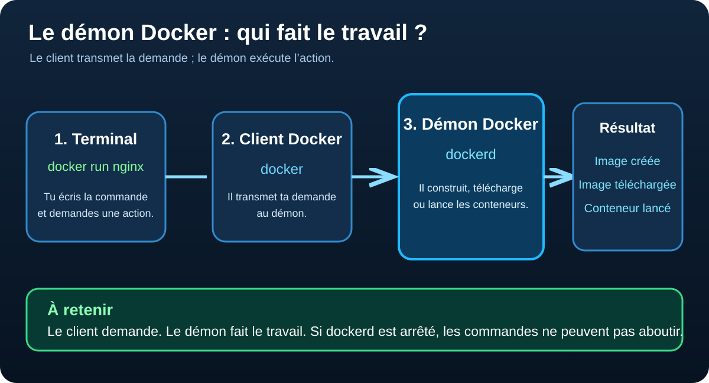
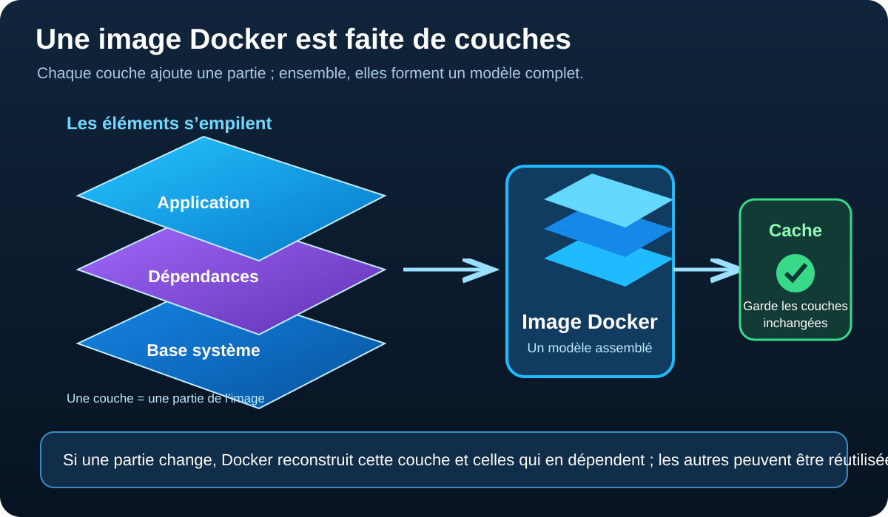

# Fiches visuelles — Docker

Ces schémas complètent le cours principal. Lis-les dans l’ordre : une notion à la fois, puis relie-les au fonctionnement global.

## 1. Le démon Docker

**À retenir :** le client Docker transmet la commande ; le démon `dockerd` réalise le travail.

## 2. Construire une image : couches et cache

**À retenir :** chaque instruction du Dockerfile ajoute une couche. Docker réutilise le cache lorsque l’instruction et ses entrées n’ont pas changé.

## 3. Lancer et inspecter un conteneur

**À retenir :** `docker run` crée et démarre un conteneur ; `docker ps` montre ceux qui tournent ; `docker logs` affiche les messages du programme.

## Suite du parcours

Les prochaines fiches détailleront séparément :
- Les volumes : conserver les données hors du conteneur
- Docker Compose : faire fonctionner plusieurs services ensemble
- Les registres : publier et télécharger des images
- Le nettoyage et les erreurs fréquentes
